# Práctica 3. Detección y reconocimiento de formas

## Tabla de contenidos
- [Introducción](#introduccion)
- [Pasos previos](#pasos-previos)
- [Tarea 1](#tarea-1)
    - [Imagen Ideal](#imagen-ideal)
    - [Detección por Webcam](#detección-por-webcam)
- [Tarea 2](#tarea-2)
- [Uso de la IA](#uso-de-la-ia)
- [Fuentes consultadas](#fuentes-consultadas)

## Introducción

En el cuaderno VC_P3 correspondiente a la [tercera práctica de la asignatura](https://github.com/otsedom/otsedom.github.io/tree/main/VC/P3) se proponen una serie de tareas que deben ser completadas. A continuación, se presenta una explicación de las distintas tareas propuestas y como se han resuelto para completarlas con éxito.

## Pasos previos

Previo a la realización de las tareas, se deberá realizar cambios al entorno configurado en la práctica 1. Este cambio reside en realizar la instalación de los paquetes _scikit-learn_ y _seaborn_ tal y como se realiza a continuación.

```
pip install scikit-learn seaborn
```

Una vez completada la instalación se podrá comenzar sin inconveniente alguno la práctica.

## Tarea 1

Para la correcta compleción de esta tarea, se tratarán dos situaciones claves:

- Imagen ideal.
- Imagen captada con webcam.

### Imagen ideal

En esta primera situación se partirá de la imagen [**"Monedas.jpg"**](Monedas.jpg), proporcionada en el guión de la práctica. 

<div align="center">


</div>

Con la imagen cargada (y su transformación a RGB), se establecerá en primer lugar las relaciones que se deberán tener en cuenta para la correcta detección. En este caso, se establecen 2 diccionarios (véase la declaración de los mismos más abajo):

- MONEDAS: establece la relación entre el tipo de moneda (2 euros, 1 euro...) y el diámetro de la misma.
- VALORES: establece la relación entre el tipo de moneda y el valor decimal de las diferentes monedas.

```
MONEDAS = {
    "2 euros": 25.75,
    "1 euro": 23.25,
    "50 cent": 24.25,
    "20 cent": 22.25,
    ...
}

VALORES = {
    "2 euros": 2.00,
    "1 euro": 1.00,
    "50 cent": 0.50,
    "20 cent": 0.20,
    ...
}
```

Con la imagen una vez cargada, se transformará esta a escala de grises y se hará uso de la función _medianBlur_ para reducir el ruido que pueda llegar a tener la imagen. Acto seguido, se procederá a la búsqueda de posibles círculos a partir de los gradientes haciendo uso de la función [_HoughCircles_](https://docs.opencv.org/4.13.0/dd/d1a/group__imgproc__feature.html#ga47849c3be0d0406ad3ca45db65a25d2d), con la cual se controlará configurando sus parámetro, valores como el radio mínimo, máximo... 

A continuación se procede a aplicar umbralización de Otsu para obtener una imagen binaria y posteriormente, se comienza con la búsqueda de contornos externos: si el centro de alguno de los círculo detectados cae dentro de uno de estos contornos, se ajustará una elipse para refinar el centro y radio del mismo.

Por último, a partir de una moneda de referencia (en este caso, de 2 euros) se calcula la relación existente entre el diámetro y los píxeles, de tal forma que se pueda calcular el diámetro del resto de detecciones. Asimismo, se comprobará si la diferencia respecto a los diámetro establecidos en _MONEDAS_ supera el valor de _TOLERANCIA_ establecido (0.6): si la supera, se la catalogará como "?"; en caso contrario, se suma al valor total en la escena (por defecto, 0.0). Finalizada esta comprobación, se procederá al dibujado de los círculos, nombres, diámetros estimados y valores de las monedas detectadas en la escena.


<div align="center">

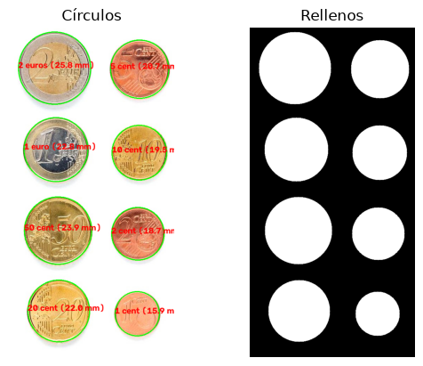

</div>

Tal y como se observa en la anterior imagen, se han detectado y catalogado correctamente todas las monedas. Por ello, el valor total detectado mostrado por pantalla en el programa será de un total de 3.88€.

<div align="center">

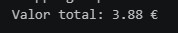

</div>


### Detección por webcam

A partir de esta versión ideal, se procederá a realizar la tarea para la detección de las monedas a partir de una webcam. 

NOTA: Se deberá tener en cuenta que los resultados dependerán de valores como la iluminación, la distancia de las monedas a la cámara, la propia cámara...

Para el planteamiento de esta situación, se han definido distintas funciones auxiliares que gestionan distintas responsabilidades en la detección. A continuación, se procederá a realizar un análisis del papel que cumplen estas funciones en la detección de las monedas.

- Selección de referencia interactiva

    La función `on_mouse()` se encarga de guardar las coordenadas del clic izquierdo del ratón. Con esta función, se podrá seleccionar una moneda de referencia previamente establecida (por ejemplo, 1 euro). De este modo, el código seleccionará la detección más cercana al punto seleccionado para posteriormente realizar el cálculo de la relación entre milímetros y píxeles mencionada anteriormente.

    ```
    def on_mouse(evento, x, y, flags, param):
        global clic
        if evento == cv2.EVENT_LBUTTONDOWN:
            clic = (x, y)
    ```

<div align="center">

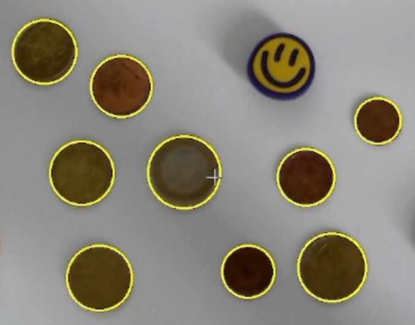

</div>

- Segmentación del folio

    El entorno de trabajo en el que se han realizado las pruebas de detección consistía de un fondo color madera, por lo que muchas de las pruebas realizadas no llegaban a detectar las monedas debido al poco contraste existente. Es por ello que para paliar este problema, se ha planteado esta función.

    La función segmentar_folio proporciona una región delimitada de trabajo y el contraste suficiente para poder aplicar el umbral de Otsu. Para ello, previamente se ha debido de convertir el fotograma capturado a gris y aplicar _medianBlur_, de manera análoga al planteamiento que se siguió para la versión estática. Calculado el umbral, se procederá a la búsqueda de contornos externos y la selección de aquella área de mayor tamaño (el folio).

    ```
    def segmentar_folio(img):
        gris = cv2.cvtColor(img, cv2.COLOR_BGR2GRAY)
        pimg = cv2.medianBlur(gris, 7)
        _, bina = cv2.threshold(pimg, 0, 255, cv2.THRESH_BINARY + cv2.THRESH_OTSU)

        # El folio es la mayor región blanca: se rellena para delimitar la zona de trabajo
        cont_f, _ = cv2.findContours(bina, cv2.RETR_EXTERNAL, cv2.CHAIN_APPROX_SIMPLE)
        if not cont_f:
            return None
        folio = np.zeros_like(bina)
        cv2.drawContours(folio, [max(cont_f, key=cv2.contourArea)], -1, 255, -1)

        # Monedas = dentro del folio y no blancas
        return cv2.bitwise_and(folio, cv2.bitwise_not(bina))
    ```
    Si no se encuentran contornos, la función devolverá None. Con esta estrategia se presupone que el folio es la región blanca de mayor tamaño capturada por la webcam y que las monedas contrastan con él. Se deberá tener en cuenta que un fondo es irregular, el folio parcialmente fuera de la visión de la webcam o la presencia de muchas sombras pueden suponer que no se produzca la detección correctamente.


- Detección

    La función `detectar()` combina la segmentación comentada anteriormente junto con morfología, geometría y anaálsi cromático.

    Esta función se encarga de convertir el fotograma captado por la webcam a HSV para realizar un análisis del color captado. Asimismo, obtiene la máscara de las monedas haciendo uso de la función segmentar_folio comentada anteriormente, y aplica apertura morfológica y cierrepara la eliminación de pequeños residuos y cierre para cubrir posibles huecos (por ejemplo, el centro de las monedas de 1/2 euros).

    Extrae además los contornos externos, descartando aquellos muy pequeños o que no cumplan los criterios válidos para ser una moneda. Acto seguido aplica filtros para descartar objetos alargados o poco circulares para, finalmente, realizar el análisis de color y conservar aquellas detecciones que no hayan sido rechazadas.

    ```
    def detectar(img):
        # Imagen en HSV para la discriminación por color
        hsv = cv2.cvtColor(img, cv2.COLOR_BGR2HSV)

        bina = segmentar_folio(img)
        if bina is None:
            return []

        # Limpieza común
        k = cv2.getStructuringElement(cv2.MORPH_ELLIPSE, (5, 5))
        bina = cv2.morphologyEx(bina, cv2.MORPH_OPEN, k)
        k2 = cv2.getStructuringElement(cv2.MORPH_ELLIPSE, (21, 21))  # cierra el centro plateado del 1 € y 2 €
        bina = cv2.morphologyEx(bina, cv2.MORPH_CLOSE, k2)

        # Localiza contornos externos
        contornos, _ = cv2.findContours(bina, cv2.RETR_EXTERNAL, cv2.CHAIN_APPROX_SIMPLE)

        lado = min(img.shape[:2])
        r_min, r_max = 0.015 * lado, 0.15 * lado  # radio como fracción del frame

        det_monedas = []
        for c in contornos:
            if len(c) < 5:
                continue
            area = cv2.contourArea(c)
            per = cv2.arcLength(c, True)
            if per == 0 or area == 0:
                continue
            circularidad = 4 * np.pi * area / per**2

            (x_coor, y_coor), (eje_a, eje_b), _ = cv2.fitEllipse(c)
            if min(eje_a, eje_b) == 0:
                continue
            det_radio = (eje_a + eje_b) / 4

            if (r_min <= det_radio <= r_max and circularidad > 0.8
                    and min(eje_a, eje_b) / max(eje_a, eje_b) > 0.85):
                fam = familia_color(hsv, x_coor, y_coor, det_radio)
                if fam is not None:
                    det_monedas.append((x_coor, y_coor, det_radio, fam))
        return det_monedas
    ```


- Análisis cromático

    Tal y como se mencionó anteriormente, en este código se hace uso de una función de análisis de color para distinguir entre los distintos tipos de moneda.

    Es importante destacar, que se habrán de definir tanto los umbrales de color a tener en cuenta como las familias a las que pertenecen cada una de estas monedas. 

    ```
    # Definición de los umbrales de color
    S_MIN = 40 
    H_COBRE_MAX = 20 
    H_FRIO_MIN, H_FRIO_MAX = 75, 150
    UMBRAL_BI_H = 8
    UMBRAL_BI_S = 50

    # Relación monedas-color

    FAMILIA = {
        "1 cent": "cobre", 
        "2 cent": "cobre", 
        "5 cent": "cobre",
        "10 cent": "oro", 
        "20 cent": "oro", 
        "50 cent": "oro",
        "1 euro": "bi", 
        "2 euros": "bi",
    }
    ```

    Una vez ha quedado esto establecido, se procederá a hablar de la función `familia_color()`.

    Tal y como ha quedado reflejado en la variable global FAMILIA, esta asigna a cada moneda la familia a la que pertenece para, a través del estudio de una región del centro de la moneda detectado en HSV, clasificar a que familia pertenece cada moneda detectada.

    De esta forma, se excluirán píxeles demasiado oscuros o brillantes (correspondientes a sombras o reflejos) y se realizará un análisis comparativo de las medianas de tono y saturación en el centro y en regiones cercanas al borde de la moneda. Asimismo, se descartarán colores fríos muy saturados (verdes, azules...) y, se considerará que un cambio apreciable entre el centro y la corona de la moneda catalogará a la misma como una moneda _bimetálica_ (1/2 euros). En caso contrario, el tono de la corona se utilizará para determinar si la moneda detectada es de cobre u oro.

    Finalmente si no se ha conseguido catalogar el color, ya sea por ausencia de suficientes píxeles o el color es poco fiable, se retornará "?". Para el caso en que el color sea ajeno al de una moneda (entre ellos, los mencionados tonos fríos) se retornará "None".

    ```
    def familia_color(hsv, x_coor, y_coor, det_radio):
        """Devuelve 'cobre', 'oro', 'bi', '?' (color no fiable) o None si es color frío."""
        x, y, r = int(x_coor), int(y_coor), int(det_radio)
        x0, y0 = max(x - r, 0), max(y - r, 0)
        roi = hsv[y0:y + r, x0:x + r]
        if roi.size == 0:
            return None

        yy, xx = np.ogrid[y0:y0 + roi.shape[0], x0:x0 + roi.shape[1]]
        dist = np.hypot(xx - x_coor, yy - y_coor)
        util = (roi[..., 2] > 60) & (roi[..., 2] < 240)   # sin sombras ni brillos especulares
        centro = (dist <= 0.4 * det_radio) & util
        # Corona pegada al borde: evita la frontera plata/oro del 1 € y 2 €
        corona = (dist >= 0.82 * det_radio) & (dist <= 0.94 * det_radio) & util
        if centro.sum() < 10 or corona.sum() < 10:
            return "?"

        h_c, s_c, _ = np.median(roi[centro], axis=0)
        h_k, s_k, _ = np.median(roi[corona], axis=0)

        # Color poco saturado: no es fiable, que decida el tamaño
        if s_c < S_MIN and s_k < S_MIN:
            return "?"

        # Descarta colores fríos (azules, verdes...) cuando están saturados
        for h, s in ((h_c, s_c), (h_k, s_k)):
            if s >= S_MIN and H_FRIO_MIN <= h <= H_FRIO_MAX:
                return None

        # Bimetálica: cambio de tono con color suficiente en ambas zonas, o gran cambio de saturación
        dh = min(abs(h_c - h_k), 180 - abs(h_c - h_k))
        if (dh > UMBRAL_BI_H and min(s_c, s_k) > S_MIN) or abs(s_c - s_k) > UMBRAL_BI_S:
            return "bi"

        return "cobre" if h_k < H_COBRE_MAX else "oro"
    ```
    <div align="center">

    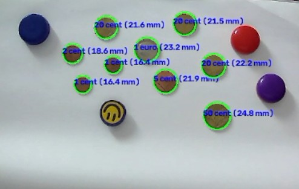

    </div>


- Seguimiento temporal

    Una vez se ejecute el bucle de código encargado de la detección de las monedas, la webcam estará capturando continuamente las mismas monedas en múltiples fotogramas: esto implicada que en cada fotograma clasificado se pueden producir parpadeos en las etiquetas asociadas a las monedas. Con el fin de reducir dichos parpadeos, se ha propuesto el uso de las funciones auxiliares `actualizar_tracks()` y `estado_track()`.

    Para el correcto funcionamiento de estas funciones, se han declarado previamente unas variables indispensables.

    ```
    N_HIST = 15
    MIN_HIST = 5
    MAX_PERDIDOS = 10
    tracks = []
    ```

    En lo referente a estas variables definidas:

    - `N_HIST`: establece los frames que se recuerdan por moneda detectada.
    - `MIN_HIST`: establece el número mínimo de observaciones para poder mostrar una clasificación.
    - `MAX_PERDIDOS`: establece el número de fotogramas mínimo sin ver una moneda antes de olvidarla.
    - `tracks`: se utiliza para almacenar el seguimiento de las monedas detectadas.

    Para asociar cada detección de las monedas en el _frame_ con el track cuyo centro está suficientemente cerca se hará uso de la función `actualizar_tracks()`; si no existiera track, se creará uno nuevo. Además, es el encargado de actualizar los valores de los _tracks_ y eliminar aquellos que lleven demasiado tiempo ausentes.
    En cambio, la función `estado_track()` es quién se encarga de devolver la mediana de los radios y la familia más votada.

    Algo importante a clarificar es que si las monedas se cruzaran, se solaparan o se produjeran movimientos bruscos en la escena, dos _tracks_ podrían llegar a confundirse.

Una vez clarificado el uso que tienen las anteriores funciones en el bucle principal de detección, se procederá a comentar el funcionamiento de este.

Para hacer posible la detección, se hace uso de la función VideoCapture() que incopora OpenCV para capturar la escena de las monedas. Capturada, se invertirá el fotograma detectado y se procesará haciendo uso de la función `detectar()`.

Acto seguido, se calibrará la relación entre mílimetros y píxeles al hacer click sobre la moneda de referencia. Realizada la calibración se procederá a la actualización de los tracks (`actualizar_tracks()`), ignorando aquellos que aún no cumplen los requisitos mínimos.

A continuación, se realizará el cálculo del diámetro para las monedas detectadas según la relación establecida por la moneda de referencia. Tras esto, se procederá a comprobar que se cumple el requisito de que el diámetro nominal esté por debajo del valor de tolerancia establecido.

No obstante, puede que solo la denominación con el diámetro no sea suficiente, por lo que se aplicará el análisis cromático de forma complementaria (únicamente se ejecuta si existen varias posibilidades para una misma moneda) para intentar determinar a que familia cromática pertenece (cobre, oro, bimetálica).

Por último, se seleccionará la denominación con menor diferencia de diámetro y se dibujará el círculo y la identificación de la moneda sobre la misma, así como se calculará el valor total observado en la escena. En el caso de que no haya candidatas compatibles, se marcará la detección como "?" y no se sumará valor alguno al total detectado.

```
REF = "1 euro" # Se establece la moneda de referencia 
TOLERANCIA = 0.8   # Se aumenta la tolerancia (mm) respecto a la situación ideal

px_por_mm = None
clic = None

vid = cv2.VideoCapture(2)
vid.set(cv2.CAP_PROP_FRAME_WIDTH, 1280)
vid.set(cv2.CAP_PROP_FRAME_HEIGHT, 720)

cv2.namedWindow("Deteccion de monedas")
cv2.setMouseCallback("Deteccion de monedas", on_mouse)

while True:
    ret, frame = vid.read()

    if ret:
        img = cv2.flip(frame, 1)

        det_monedas = detectar(img)

        # Calibración: píxeles por milímetro a partir de la moneda de referencia clicada
        if clic and det_monedas:
            x_ref, y_ref, r_ref, _ = min(
                det_monedas, key=lambda m: np.hypot(m[0] - clic[0], m[1] - clic[1])
            )
            if np.hypot(x_ref - clic[0], y_ref - clic[1]) <= r_ref:
                diam_ref_px = 2 * r_ref
                px_por_mm = diam_ref_px / MONEDAS[REF]
        clic = None

        # Seguimiento temporal: acumula historial de radio y familia por moneda
        actualizar_tracks(det_monedas)

        if px_por_mm:
            # Inicialización del valor total de monedas detectadas
            total = 0.0

            for t in tracks:
                if not t["visto"] or len(t["radios"]) < MIN_HIST:
                    continue
                r_med, fam = estado_track(t)
                x_coor, y_coor, det_radio = t["x"], t["y"], r_med
                diam_mm = 2 * det_radio / px_por_mm

                # 1º el tamaño: candidatas compatibles por diámetro
                candidatas = {n: d for n, d in MONEDAS.items() if abs(d - diam_mm) <= TOLERANCIA}

                # 2º el color solo desempata si hay más de una candidata
                if len(candidatas) > 1 and fam != "?":
                    por_color = {n: d for n, d in candidatas.items() if FAMILIA[n] == fam}
                    if por_color:
                        candidatas = por_color

                if candidatas:
                    nombre, diam_real = min(candidatas.items(), key=lambda m: abs(m[1] - diam_mm))
                    total += VALORES[nombre]
                    color = (0, 255, 0)
                else:
                    nombre = "?"
                    color = (0, 0, 255)

                cv2.circle(img, (int(x_coor), int(y_coor)), int(det_radio), color, 2)

                # Texto sobre la moneda detectada
                cv2.putText(
                    img,
                    f"{nombre} ({diam_mm:.1f} mm)",
                    (int(x_coor - det_radio), int(y_coor)),
                    cv2.FONT_HERSHEY_SIMPLEX,
                    0.5,
                    (255, 0, 0),
                    2,
                )

            cv2.putText(img, f"Valor total: {total:.2f} EUR", (10, 35),
                        cv2.FONT_HERSHEY_SIMPLEX, 1, (0, 255, 0), 2)
        else:
            for x_coor, y_coor, det_radio, fam in det_monedas:
                cv2.circle(img, (int(x_coor), int(y_coor)), int(det_radio), (0, 255, 255), 2)
            cv2.putText(img, f"Clic sobre una moneda de {REF}", (10, 35),
                        cv2.FONT_HERSHEY_SIMPLEX, 0.8, (0, 0, 255), 2)

        cv2.putText(img, "r recalibrar | ESC salir",
                    (10, img.shape[0] - 10), cv2.FONT_HERSHEY_SIMPLEX, 0.5, (255, 255, 255), 1)
        cv2.imshow("Deteccion de monedas", img)

    tecla = cv2.waitKey(20) & 0xFF
    if tecla == 27:  # ESC
        break
    elif tecla == ord("r"):  # Recalibra con la moneda de referencia
        px_por_mm = None
        tracks = []

vid.release()
cv2.destroyAllWindows()
```

Con la ejecución del anterior bucle de ejecución, se obtendrá el total de monedas detectadas en la escena. Como ya se mencionó anteriormente, la detección dependerá de factores como la iluminación, la posición... Para realizar las pruebas, se hizo uso de una cámara que presentaba efecto barril, por lo que la imagen tiende a deformarse.

Asimismo, para la realización de las pruebas se hiizo uso del siguiente conjunto de monedas:
- `1 euro`: 1 moneda
- `50 céntimos`: 1 moneda
- `20 céntimos`: 3 monedas
- `5 céntimos`: 1 moneda
- `2 céntimos`: 1 moneda
- `1 céntimo`: 2 monedas

 A continuación, se procede al análisis de la detección con la webcam.

| Captura a 15 centímetros | Captura a 39 centímetros |
| :---: | :---: |
| 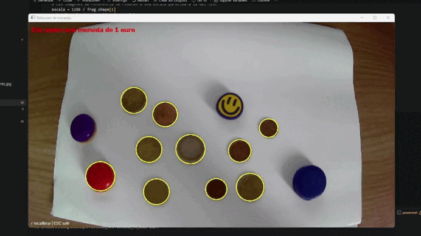 |  |

Cuando se realizaba la detección se podía notar como la imagen se deformaba más que cuando se colaba en un punto fijo (en este caso, agarrada a un monitor). Por ello, se tomó la decisión de que el resto de pruebas se realizarían con la cámara posicionada en dicho lugar.

Se realizaron dos pruebas: una realizada sólo con monedas y otra con monedas y objetos que se le pudieran asemejar. 

Cuando se realizó con monedas, pudo detectarse el total en escena de una manera correcta. No obstante, en ocasiones por la iluminación del entorno de pruebas y los cambios en la misma, el resultado podía variar ligeramente del total real (2,19 €).

<div align="center">


</div>

Para el entorno con "obstáculos", se pretendía estudiar si aquellos objetos que podían parecer una moneda (tanto por forma como por color) eran ignorados a la hora de catalogarlos. 

| Prueba 1 | Prueba 2 |
| :---: | :---: |
| 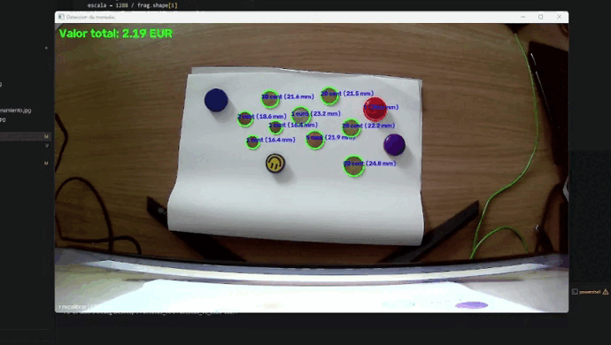 | 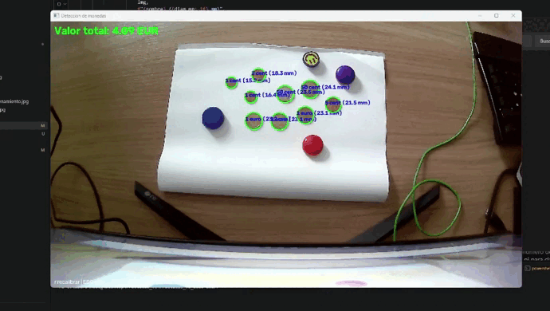 |

Tal y como se puede observar, no se llega a detectar ninguno de los objeto con tonalidades frías, quedando totalmente descartados como monedas. No obstante, el obstáculo color rojizo tiende a ser catalogado en ocasiones como una posible moneda (véase prueba 1), mas no se le asigna valor alguno. También queda presente que un cambio en la iluminación puede hacere que el resultado cambie bruscamente (véase prueba 2 cuando el valor total cambia de 4,XX € a 2,XX €, siendo XX valores decimales).

## Tarea 2

Para esta tarea, se plantea la extracción de características de las tres imágenes completas de partida con el fin de aprender patrones y posteriormente, identificar las partículas en nuevas imágenes.

Por ello, en primer lugar se establecerá con qué partículas estamos trabajando:

- `FRA`: hace referencia a fragmentos de plástico.
- `PEL`: hace referencia a pellets.
- `TAR`: hace referencia a alquitrán.

En primer lugar, se deberá realizar la carga de las imágenes de fragmentos, pellets y alquitrán que se proporciona en el guión práctico.

```
frag = cv2.imread("./referencia/fragment-03-olympus-10-01-2020.JPG")
pellet = cv2.imread("./referencia/pellet-03-olympus-10-01-2020.JPG")
tar = cv2.imread("./referencia/tar-03-olympus-10-01-2020.JPG")
```

<div align="center">

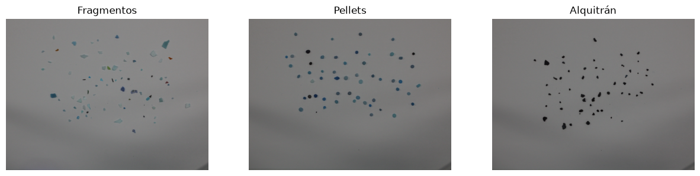

</div>

Realizada la carga, se procederá al recorte de las imágenes para reducir las zonas que carecen de las ya anteriormente mencionadas partículas. De esta forma, se consigue obtener una zona de búsqueda en la que las partículas se encuentran más concentradas, con apenas espacios sin partículas.

```
# Recortes de las imágenes con las que trabajamos
frag_crop = frag[(slice(200, 2750), slice(700, 4250))]
pellet_crop = pellet[(slice(175, 2400), slice(700, 4100))]
tar_crop = tar[(slice(350, 2600), slice(900, 3800))]
```

<div align="center">

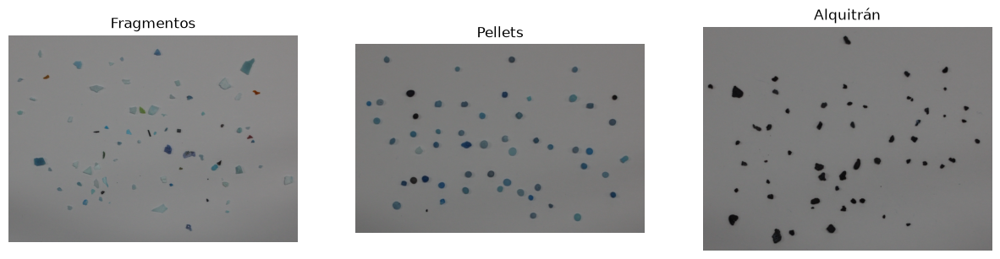

</div>

De igual manera, para la segmentación se hará uso de una función denominada `contornos()`. La función convierte la imagen a escala de grises y aplica un desenfoque gaussiano para reducir el ruido. Además, estima un fondo suavizado para el cálculo de la diferencia absoluta entre la imagen y este fondo estimado. A partir de esta referencia, se umbralizará con un umbral de 8 para separar los píxeles del fondo. Finalmente, se procede a la búsqueda de contornos externos, conservando únicamente aquellos que supear un área mínima establecida.

```
def contornos(img_rgb, escala=1.0):
    # Gris
    img = cv2.cvtColor(img_rgb, cv2.COLOR_RGB2GRAY)
    img = cv2.resize(img, None, fx=escala, fy=escala)

    # Blur
    img = cv2.GaussianBlur(img, (5, 5), 0)

    # Resta de fondo
    fondo = cv2.resize(cv2.medianBlur(cv2.resize(img, (400, 300)), 31), img.shape[::-1])

    # Umbral
    _, bw = cv2.threshold(cv2.absdiff(img, fondo), 8, 255, cv2.THRESH_BINARY)

    # Búsqueda de contornos
    cs, _ = cv2.findContours(bw, cv2.RETR_EXTERNAL, cv2.CHAIN_APPROX_SIMPLE)
    return [c for c in cs if cv2.contourArea(c) > 40], bw
```

Se calcula además una escala común y se aplica a los tres recortes de entrenamiento para aproximar su anchura a la escala de la imagen de test, de modo que las características geométrias sean más comparables.

```
# Las imágenes de referencia se reducen a una escala parecida a la del test
escala = 1288 / frag.shape[1]
print("Escala de reducción: ", escala)

cs_frag, bw_frag = contornos(frag_crop, escala)
cs_pellet, bw_pellet = contornos(pellet_crop, escala)
cs_tar, bw_tar = contornos(tar_crop, escala)
print("Partículas: ", len(cs_frag), len(cs_pellet), len(cs_tar))

```

<div align="center">

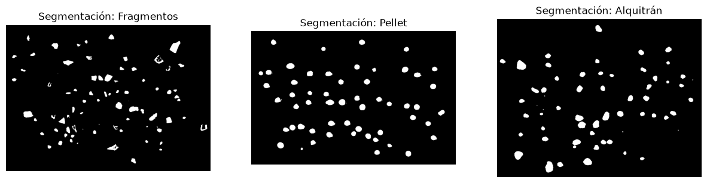

</div>

Asisimo, se deberán de extrar las características geométricas de estas partículas, por lo que se procederá a definir la función `características()`.

Esta función, para cada contorno, obtiene los siguientes 4 descriptores:

- Compacidad: resume cuánto perímetro tiene la partícula en relación con su área.

- Ocupación de la caja: mide que fracción de caja ocupa el contorno.

- Relación de aspecto: establece que valores próximos a 1 indican una caja aproximadamente cuadrada, mientras que valores altos indican una caja de forma alargada.

- Relación de ejes de la elipse: establece que aquellos valores próximos a 1 indican una forma más redondeada, mientras que los valores menores una forma más alargada.

```
def caracteristicas(c):
    area, per = cv2.contourArea(c), cv2.arcLength(c, True)
    x, y, w, h = cv2.boundingRect(c)
    (_, _), (e1, e2), _ = cv2.fitEllipse(c)
    return [
        per**2 / area,              # compacidad
        area / (w * h),             # área / contenedor
        max(w, h) / min(w, h),      # ancho / alto
        min(e1, e2) / max(e1, e2),  # ejes de la elipse
    ]
```

Si bien estos atributos extraídos describen la forma sin depender directamente del color, no son suficientes por sí solos para separar fragmentos y pellets. No obstante, ofrecen una representación numérica simple y explicable.

Una vez extraídas las características, se recorrerán los contornos extraídos ded cada imagen y se construyen obteniendo:

- X: matriz de características geométricas, una fila por partícula.
- y: vector de etiquetas asignadas según la imagen de procedencia.

```
UMBRAL_TAR = 0.6

X, y = [], []
for cs, clase in [(cs_frag, "FRA"), (cs_pellet, "PEL"), (cs_tar, "TAR")]:
    for c in cs:
        X.append(caracteristicas(c))
        y.append(clase)
X, y = np.array(X), np.array(y)
```

Asimismo y debido a que el alquitrán tiende a ser visualmente más oscuro que el fondo, se definirá una nueva función llamada `oscuridad()`.

Dicha función, crea una máscara rellena del contorno. Una vez creada, se dilata la misma y se calcula una región exterior que evita parte de los píxeles cercanos al borde. A continuación, obtiene los píxeles interiores de la partícula para calcuular su intensidad media (escala de grises) y posteriormente, se selecciona el 30% más oscuro de los píxeles interiores para representar el núcleo oscuro. Finalmente, se comparará la intensidad de ese núcleo con la intensidad media del fondo exterior.

```
def oscuridad(img, c):
    mask = np.zeros(img.shape[:2], np.uint8)
    cv2.drawContours(mask, [c], -1, 255, -1)
    fuera = cv2.bitwise_not(cv2.dilate(mask, np.ones((15, 15), np.uint8)))
    dentro = img[mask > 0].astype(float)
    gris = dentro.mean(1)
    nucleo = dentro[gris <= np.percentile(gris, 30)].mean(0)
    return (nucleo / img[fuera > 0].mean(0)).mean()  # 1 = como el fondo, 0 = negro
```

La razón obtenida establece que un valor cercano a 1 indica una intensidad similar al fondo, mientras que uno cercano a 0 una región muy oscura. Se hará uso además de la variable UMBRAL_TAR para comprobar si `oscuridad` es menor al umbral establecido. En dicho caso, se predecirá como `TAR`.

Una vez se han extraído las partículas geométricas de las partículas, se hará uso de estas para distinguir entre fragmentos y pellets (se excluye TAR, puesto que esta distinción ya la realiza `oscuridad`).

En primer lugar, se calculará la media  y desviación típica de cada una de las características haciendo uso de las muestras de entrenamiento de estas partículas. De esta forma, se normalizarán las características y se evitará que aquellas cuyos valores numéricos sean muy elevados influyan de manera desproporcional en la clasificación.

Posteriormente, se calcula un prototipo para clase definido como la media de sus características normalizadas. De esta forma, se podrá clasificar cada partícula comparando su representación geométric acon los prototipos de ambas categorías.
```
clases = ["FRA", "PEL"]
x2, y2 = X[y != "TAR"], y[y != "TAR"]
mu, sd = x2.mean(0), x2.std(0)
medias = [((x2[y2 == k] - mu) / sd).mean(0) for k in clases]
```

Una vez se han definido los prototipos, se implementa la función `predice()` para realizar la predicción. Se comprobará en primera instancia si esta es alquitrán y, en caso contrario, se calcularán sus características normalizadas para compararlas con los prototipos de framentos y pellets mediante distancia euclídea.

```
def predice(img, c):
    if oscuridad(img, c) < UMBRAL_TAR:
        return "TAR"
    f = (np.array(caracteristicas(c)) - mu) / sd
    return clases[np.argmin([np.linalg.norm(f - m) for m in medias])]
```

Con el clasificador anterior definido, se procederá a cargar la [imagen de test](./test/MPs_test.jpg). Con la imagen cargada se ejecutará la función `contornos()`, de modo que esta retornará las partiículas detectadas (`cs_test`) y la máscara binaria correspondiente (`bw_test`).

```
test = cv2.cvtColor(cv2.imread("./test/MPs_test.jpg"), cv2.COLOR_BGR2RGB)
cs_test, bw_test = contornos(test)
```

<div align="center">

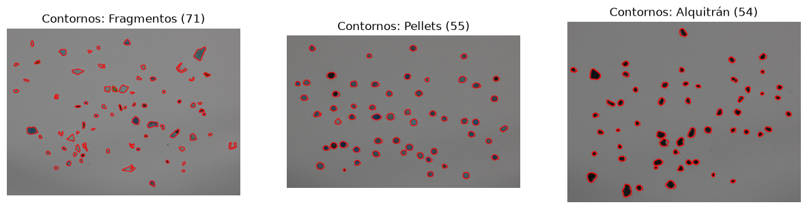

</div>

Para evaluar el funcionamiento, se hará uso del [archivo CSV](./test/MPs_test_bbs.csv) proporcionado en el guión práctico, el cual contiene las anotaciones de las partículas de la imagen de test. De cada anotación, se obtendrán tanto la etiqueta real como las coordenadas de su caja delimitadora.

A partir de estas últimas se calculará el centro de cada caja de modo que se use este para buscar el contorno detectado que presente la mayor proximidad al centro de rotación. Así, una vez encontrado el contorno, se aplicará la función `predice()` definida anteriormente.

```
anot = []
with open("./test/MPs_test_bbs.csv", newline="") as file:
    for fila in csv.DictReader(file):
        anot.append(
            (
                fila["label"],
                int(fila["x_min"]),
                int(fila["y_min"]),
                int(fila["x_max"]),
                int(fila["y_max"]),
            )
        )
colores = {"FRA": (255, 0, 0), "PEL": (0, 255, 0), "TAR": (0, 0, 255)}
img_anot, img_pred = test.copy(), test.copy()
real, pred = [], []
for etiqueta, x_min, y_min, x_max, y_max in anot:
    centro = ((x_min + x_max) / 2, (y_min + y_max) / 2)
    c = max(cs_test, key=lambda c: cv2.pointPolygonTest(c, centro, True))
    p = predice(test, c)
    real.append(etiqueta)
    pred.append(p)
    cv2.rectangle(img_anot, (x_min, y_min), (x_max, y_max), colores[etiqueta], 2)
    cv2.drawContours(img_pred, [c], -1, colores[p], 2)
```

<div align="center">

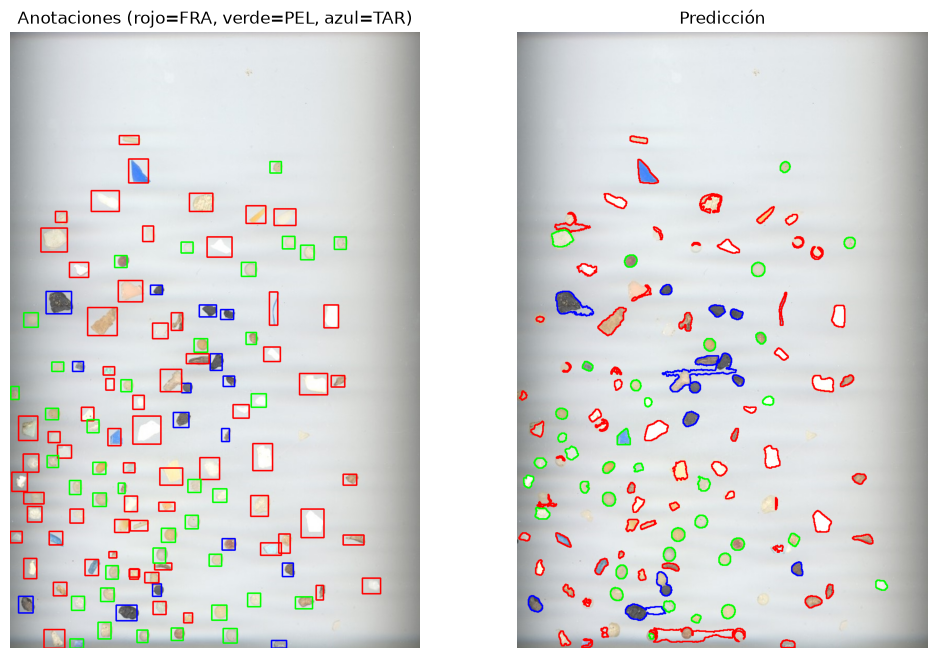

</div>

Finalmente, una vez obtenidas las etiquetas reales y las predicciones se procederá a evaluar el rendimiento del sistema mediante la tasa de acierto y la precisión ponderada.

La tasa de acierto representa la proporción de partículas cuya etiqueta real coincide con la clase predicha, mientras que la precisión ponderada calcula la precisión de cada clase y obtiene una media ponderada en base al número de muestras pertenecientes a cada categoría.

Con esta información, se construirá una matriz de confusión, en la cual las filas representan las clases reales y las columnas las clases predichas.

```
accuracy = accuracy_score(real, pred)
precision = precision_score(real, pred, average="weighted", zero_division=0)

print("\nMÉTRICAS:")
print(f"Tasa de acierto  = {accuracy:.3f}")
print(f"Precisión = {precision:.3f}")

clases = ["FRA", "PEL", "TAR"] # Se define TAR antes de hacer la matriz de confusión
cm = confusion_matrix(real, pred, labels=clases)
```

<div align="center">

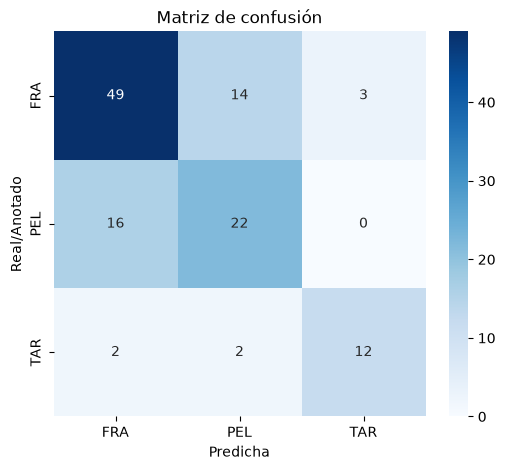

</div>

## Uso de la IA

En el desarrollo de esta práctica se ha hecho uso de herramientas de IA de forma complementaria para el desarrollo de algunas tareas. 

Algunas de los aspectos de esta entrega en las que se hizo uso de IA han sido:

- Desarrollo de la función de análisis cromático: para el análisis del color, se utilizó para ver como abordar el problema de la discriminación por colores (rechazar tonos fríos, establecer los rangos de color de las monedas...) de manera que pudieran obtenerse resultados exitosos.

- Función de estabilización en la detección de los fotogramas: originalmente no se trataba de ninguna forma la visión de las monedas en cada fotograma, por lo que cada en cada frame se trataba la moneda como una nueva aparición, lo que hacía el dibujado de los círculos sobre estas algo inestable. Es por ello que con ayuda de herramientas como Claude y ChatGPT se diseñó una solución para tratar de paliar este problema en la mayor magnitud posible.


## Fuentes consultadas

- [Documentación de OpenCV](https://docs.opencv.org/4.13.0/d6/d00/tutorial_py_root.html)
- [Documentación de numpy](https://numpy.org/doc/stable/reference/module_structure.html)
