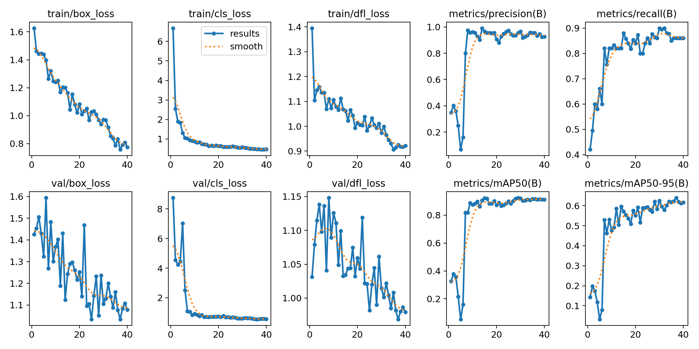
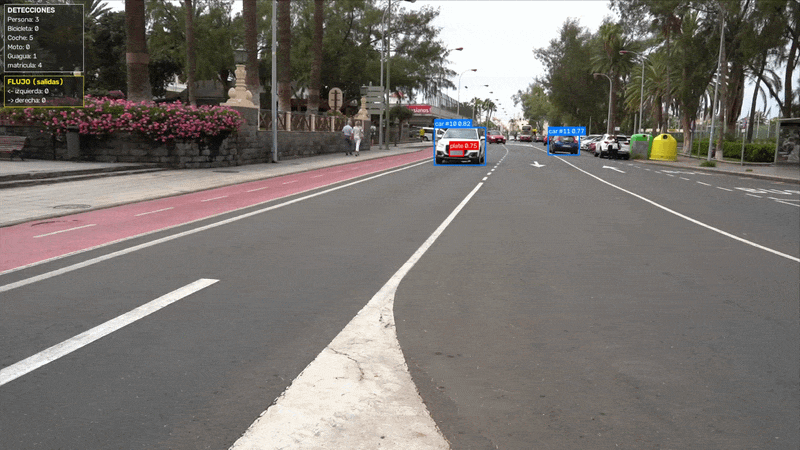
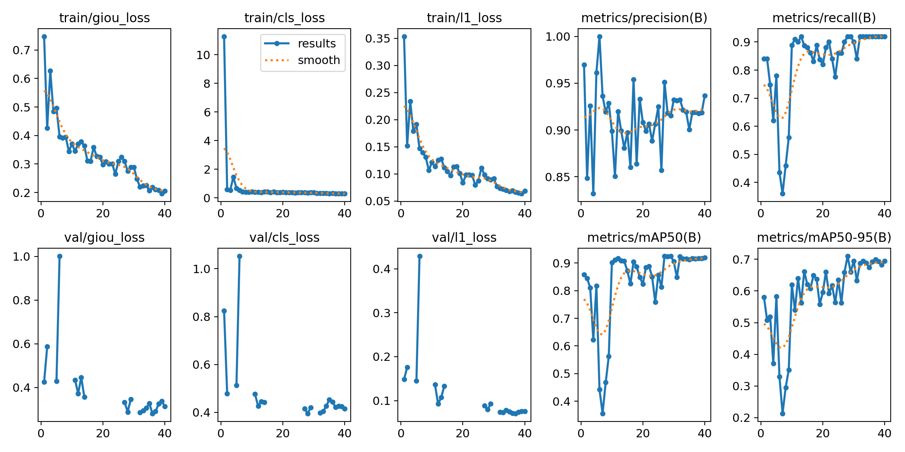
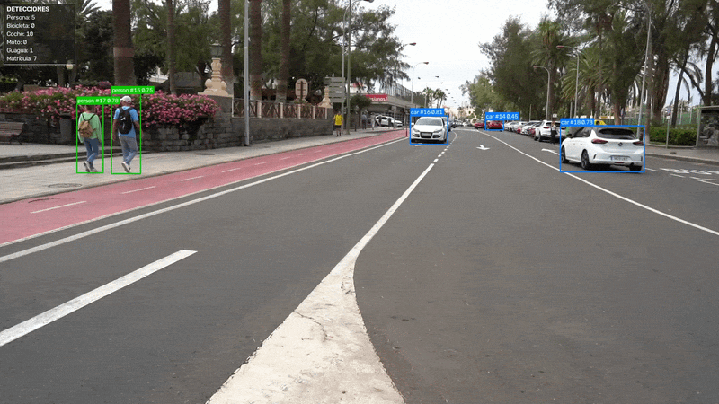
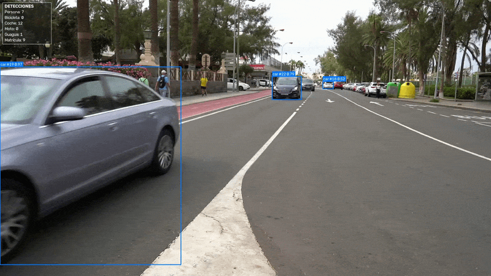

# Práctica 4. Detección de vehículos y matrículas

## Tabla de contenidos
- [Introducción](#introduccion)
- [Pasos previos](#pasos-previos)
- [Especificaciones del equipo](#Especificaciones-del-equipo)
- [Parte A](#parte-a-detección-y-seguimiento-de-personas-y-vehículos-y-detección-de-matrículas-yolo-vs-rt-detr)
    - [Descripción](#descripción)
    - [Detección con YOLOv11](#detección-con-yolov11)
    - [Detección con RT-DETR](#detección-con-rt-detr)
    - [Comparativa YOLO vs. RT-DETR](#comparativa-yolo-vs-rt-detr)
- [Parte B](#parte-b-lectura-de-matrículas-ocr-easyocr-vs-smolvlm2)
    - [Descripción](#descripción-1)
    - [Carga de modelos](#carga-de-modelos)
    - [Funciones de inferencia](#funciones-de-inferencia)
    - [Ejecución](#ejecución)
    - [Estructura del dataset del OCR](#estructura-del-dataset-del-ocr)
    - [Metrícas](#métricas)
    - [Resultados obtenidos](#resultados-obtenidos-81-imágenes)
    - [Vídeo con OCR](#vídeo-con-ocr)
- [Acceso a recursos](#acceso-a-recursos)
- [Fuentes consultadas](#fuentes-consultadas)

## Introducción

En el cuaderno VC_P4 correspondiente a la [cuarta práctica de la asignatura](https://github.com/otsedom/otsedom.github.io/tree/main/VC/P4) se proponen una serie de tareas que deben ser completadas. A continuación, se presenta una explicación de las distintas tareas propuestas y como se han resuelto para completarlas con éxito.

## Pasos previos

Para la [parte A](#parte-a-detección-y-seguimiento-de-personas-y-vehículos-y-detección-de-matrículas-yolo-vs-rt-detr), creamos un entorno en Anaconda llamado VC_P4:
```bash
conda create --name VC_P4 python=3.9.5
```
Luego, se activa el entorno:
```bash
conda activate VC_P4
```
Una vez activado, se instalan los siguientes paquetes:
```bash
pip install ultralytics lap tensorboard faster_coco_eval
```
Incluyendo esto:
```bash
conda install pytorch==1.12.1 torchvision==0.13.1 torchaudio==0.12.1 cudatoolkit=11.6 -c pytorch -c conda-forge
```
---
Por problemas de incompatibilidad entre paquetes del entorno anterior para la [parte B](#parte-b-lectura-de-matrículas-ocr-easyocr-vs-smolvlm2), nos vimos forzados a crear un entorno en Anaconda llamado VC_P4b:
```bash
conda create --name VC_P4b python=3.9.5
```
Luego, activamos el entorno:
```bash
conda activate VC_P4b
```
E instalamos las dependencias necesarias:
```bash
pip install pytesseract easyocr paddleocr transformers ultralytics paddlepaddle-gpu num2words
```

## Especificaciones del equipo

Para la realización de la mayoría de pruebas, en su mayoría las finales, se ha hecho uso de un equipo con las presentes prestaciones:

- `CPU`: AMD Ryzen 7 260 w/ Radeon 780M Graphics (3.80 GHz)
- `Memoria RAM`: 32GB
- `Tarjeta Gráfica`: NVIDIA GeForce RTX 5070 Laptop GPU (8 GB)
- `Sistema Operativo`: Windows 11 Home Versión 26H2

## Parte A. Detección y seguimiento de personas y vehículos, y detección de matrículas (YOLO vs. RT-DETR)
 
### Descripción
 
El notebook [P4.ipynb](P4_main.ipynb) procesa un vídeo de tráfico con **YOLOv11n** y posteriormente con **RT-DETR** para:
 
- Detectar y **seguir** personas y vehículos (bicicleta, coche, moto, guagua).
- Detectar **matrículas** dentro del recorte de cada vehículo con un modelo entrenado a medida.
- **Anonimizar** (pixelar) caras y matrículas (solo **YOLOv11n**).
- **Contar** objetos únicos y calcular el **flujo de salidas** por los bordes izquierdo y derecho (solo **YOLOv11n**).
- Generar un **vídeo anotado** y un **CSV** con todas las detecciones.
- **Comparar** los dos detectores de matrículas entrenados con el mismo dataset.


### Detección con YOLOv11

Se realizará una aproximación inicial a la detección de matrículas con YOLOv11.

Para ello se definirán los modelos así como funciones auxiliares de guardado, pixelado y de detección de flujo con el fin de proporcionar una solución que satisfaga el supuesto práctico planteado. Asimismo con la separación de estas funciones del bucle principal, estas podrán ser reutilizadas para el modelo de detección de matrículas [RT-DETR](#detección-con-rt-detr).

#### Configuración y modelos

Se cargan el detector general (`yolo11n.pt`, COCO) y el detector de matrículas entrenado, y se definen las clases de interés y los parámetros.

```python
source_video = "C0142.mp4"
output_video = "output.mp4"
csv_output = "detections.csv"

# Carga de los modelos: preentrenado y detección de matrículas
general_model = YOLO("yolo11n.pt")
plate_model = YOLO("./runs/detect/yolo_runs/plates_detection/weights/best.pt")

# Definición de las clases de interés
PERSON = 0
VEHICLES = {1, 2, 3, 5}  # bicicleta, coche, moto, guagua
CLASSES = [PERSON, *VEHICLES]
PLATE_VEHICLES = {2, 3, 5}  # vehículos con matrícula

# Parámetros de detección y recorte
conf_coco = 0.4
conf_plate = 0.3
padding = 0.05  # margen extra alrededor del vehículo (5%)

face_ratio = 0.22  # se asume que la fracción superior de la caja es la cara

# Parámetros del flujo
margin = 0.08
min_history = 5
lost_frames = 15
directions = ["izquierda", "derecha"]
```

#### Entrenamiento del detector de matrículas (Anaconda Prompt)

Con el directorio actual en `P4`:

```bash
# GPU (CUDA)
yolo detect train data=data.yaml model=yolo11n.pt imgsz=416 batch=4 device=0 epochs=40 project=yolo_runs name=plates_detection exist_ok=True hsv_h=0.015 hsv_s=0.5 hsv_v=0.3 degrees=5 translate=0.1 scale=0.3 fliplr=0.0 mosaic=0.5

# CPU
yolo detect train data=data.yaml model=yolo11n.pt imgsz=416 batch=4 device=cpu epochs=40 project=yolo_runs name=plates_detection exist_ok=True hsv_h=0.015 hsv_s=0.5 hsv_v=0.3 degrees=5 translate=0.1 scale=0.3 fliplr=0.0 mosaic=0.5
```

<div align="center">



</div>

**Funciones de pérdida**

- Las tres pérdidas de entrenamiento descienden de forma continua: `box_loss` de 1,6X a 0,7X, `cls_loss` de 6,6X a 0,47 aproximadamente y `dfl_loss` de 1,3X a 0,9X. La gráfica pérdida de clasificación converge muy rápido (alrededor de la época 10 aproximadamente), mientras que `box_loss` y `dfl_loss` siguen decreciendo al final, lo cual indica que el modelo podría seguir ajustando la localización con un número mayor de épocas.

- Las pérdidas de validación también bajan, pero son mucho más ruidosas, presentando picos puntuales en las épocas 6 y 22. Es un resultado esperable debido al reducidoconjunto de validación (de solo 43 imágenes) y un batch de 4.

- Hay una brecha entre entrenamiento y validación en la pérdida de caja. Es una ligera señal de sobreajuste, pero la pérdida de validación sigue una tendencia descendente y las métricas no empeoran, por lo que no es preocupante.

**Métricas de validación**

- **Inestabilidad inicial:** la precisión cae hasta ≈0,07 en la época 5 y el mAP50 hasta ≈0,05. Es el periodo de calentamiento, con el modelo aún descalibrado.

- **Salto en la época 7-8:** la precisión pasa a ≈0,97 y el mAP50 a ≈0,82, y a partir de la época 14 se estabiliza en torno a 0,91-0,92.

- **Precisión:** se mantiene entre 0,90 y 0,99 y termina en 0,926.

- **Recall:** crece de forma más lenta, con un máximo de aproximdamanete 0,90 hacia la época 30. Es inferior a la precisión: el modelo es conservador y deja escapar en torno al 14 % de las matrículas, pero comete pocos falsos positivos.

- **mAP50-95:** sigue una tendencia ascendente hasta el final. A diferencia del mAP50, que se satura pronto, esto indica que el ajuste fino de las cajas seguía mejorando.

Con estas observaciones, se puede concluir que el entrenamiento converge de manera estable tras un arranque inestable. El detector localiza bien la matrícula (mAP50 > 0,9), pero el ajuste preciso de la caja y el recall son sus puntos más débiles. Una forma de conseguir mejoría podría ser entrenar el modelocon más épocas, con un batch mayor o con más datos de validación.

#### Funciones auxiliares del CSV

El CSV tiene una fila por objeto y fotograma, con las columnas:

| fotograma | tipo_objeto | confianza | identificador_tracking | x1  | y1  | x2  | y2  | matricula_en_su_caso | confianza | mx1 | my1 | mx2 | my2 | texto_matricula |
| ----- | ----------- | --------- | -------- | --- | --- | --- | --- | ----- | ---------- | --- | --- | --- | --- | --- |
|       |             |           |          |     |     |     |     |       |            |     |     |     |     |     |

Una vez se realiza la detección se identifican dos posibles escenarios, variando ligeramente la información almacenada:

- Se detecta matrícula:

| fotogramaa | tipo_objeto | confianza | identificador_tracking | x1  | y1  | x2  | y2  | matricula_en_su_caso | confianza | mx1 | my1 | mx2 | my2 | texto_matricula |
| ----- | ----------- | --------- | -------- | --- | --- | --- | --- | ----- | ---------- | --- | --- | --- | --- | --- |
|   10   |       bus      |    0.941       |     1     |  1383   |  92   |   1918  |  457   |  Si     |     0.685       |  1768   |   397  |  1829   |  415   |     |

- No se detecta matrícula:

| fotogramaa | tipo_objeto | confianza | identificador_tracking | x1  | y1  | x2  | y2  | matricula_en_su_caso | confianza | mx1 | my1 | mx2 | my2 | texto_matricula |
| ----- | ----------- | --------- | -------- | --- | --- | --- | --- | ----- | ---------- | --- | --- | --- | --- | --- |
|   10   |       car      |    0.806       |     2     |  1311   |  312   |   1386  |  368   |  No     |            |     |     |     |     |     |

En cualquiera de los casos no se producirá la lectura y guardado de la matrícula (se abarcará en la [Parte B](#parte-b-lectura-de-matrículas-ocr-easyocr-vs-smolvlm2)).


```python
def write_csv_header(path): ...      # crea el CSV con la cabecera
def make_row(frame_n, name, conf, tid, box, plate=None): ...   # construye una fila
def append_rows(path, rows): ...     # añade filas al CSV
```

#### Funciones de dibujado, anonimizado y flujo

**Pixelado** (anonimizado de caras y matrículas): reduce la región y la vuelve a ampliar con interpolación `INTER_NEAREST`.

```python
def pixelate(frame, box, factor=10):
    x1, y1, x2, y2 = map(int, box)
    x1, y1 = max(0, x1), max(0, y1)
    x2, y2 = min(w, x2), min(h, y2)
    roi = frame[y1:y2, x1:x2]
    if roi.size == 0:
        return
    rh, rw = roi.shape[:2]
    small = cv2.resize(roi, (max(1, rw // factor), max(1, rh // factor)),
                       interpolation=cv2.INTER_LINEAR)
    frame[y1:y2, x1:x2] = cv2.resize(small, (rw, rh), interpolation=cv2.INTER_NEAREST)
```

**Cálculo del flujo**: un objeto cuenta como "salida" si lleva más de `lost_frames` fotogramas sin verse, tiene historial suficiente y su última posición está cerca de un borde lateral.

```python
def exit_direction(cx, cy):
    if cx <= w * margin:
        return "izquierda"
    if cx >= w * (1 - margin):
        return "derecha"
    return None


def update_exits(current_frame):
    for tid in [t for t, f in last_seen.items() if current_frame - f > lost_frames]:
        hist = track_history.pop(tid)
        del last_seen[tid]
        if len(hist) >= min_history and tid not in counted_exit:
            d = exit_direction(*hist[-1])
            if d:
                exit_count[d][track_class[tid]] += 1
                counted_exit.add(tid)
```

Otras funciones: `draw` (caja con etiqueta), `draw_panel` (panel semitransparente) y `render` (paneles de **DETECCIONES** y **FLUJO**).

#### Bucle principal de procesado

Por cada fotograma:

1. `general_model.track(..., persist=True)` devuelve cajas, clases y **IDs de seguimiento**.
2. Se actualizan los conjuntos de IDs únicos y el historial de trayectorias (`deque(maxlen=30)`).
3. Para **personas** se pixela la franja superior de la caja (cara).
4. Para **vehículos con matrícula** se recorta el vehículo con margen, se detecta la matrícula con la mayor confianza y se convierten las coordenadas del recorte a coordenadas del fotograma.
5. Se guardan las filas en el CSV, se actualizan las salidas, se pixelan las cajas y se dibuja el resultado.

```python
if cls in PLATE_VEHICLES:
    bw, bh = x2 - x1, y2 - y1
    cx1 = max(0, int(x1 - bw * padding)); cy1 = max(0, int(y1 - bh * padding))
    cx2 = min(w, int(x2 + bw * padding)); cy2 = min(h, int(y2 + bh * padding))
    crop = frame[cy1:cy2, cx1:cx2]
    if crop.size:
        res = plate_model.predict(crop, conf=conf_plate, verbose=True)[0]
        if len(res.boxes):
            i = int(res.boxes.conf.argmax())           # mejor matrícula del recorte
            pconf = float(res.boxes.conf[i])
            px1, py1, px2, py2 = res.boxes.xyxy[i].cpu().numpy()
            plate = (pconf, int(px1 + cx1), int(py1 + cy1),   # coordenadas globales
                            int(px2 + cx1), int(py2 + cy1))
```

Salidas: `output.mp4` y `detections.csv`.
<div align="center">
    
    <p>Muestra del vídeo con la detección YOLOv11.</p>
</div>

### Detección con RT-DETR

#### Entrenamiento

Mismo dataset (`data.yaml`) para poder comparar. Se puede entrenar por línea de comandos (`rtdetr-l.pt`, `imgsz=416`, `epochs=40`, mismos hiperparámetros de aumento) o alternativamente se podría realizar desde el notebook:

```python
data_yaml = "./data.yaml"
rtdetr_plate_path = "./runs/detect/rtdetr_runs/plates_detection/weights/best.pt"
```

Validación rápida:

```python
rtdetr_metrics = RTDETR(rtdetr_plate_path).val(data=data_yaml, imgsz=640, verbose=False)
# precision, recall, mAP50, mAP50-95
```

<div align="center">



</div>

**Funciones de pérdida**

- Las tres pérdidas de entrenamiento descienden de forma sostenida: `giou_loss` de 0,7X a 0,2X, `cls_loss` de 11,XX a 0,3X y `l1_loss` de 0,35 a 0,07. La pérdida de clasificación colapsa en las primeras épocas y las de caja (GIoU y L1) siguen decreciendo hasta el final, sin conseguir llegar a estabilizarse.

- **Las pérdidas de validación no están disponibles en 20 de las 40 épocas** (valores `NaN` en el `results.csv`, de ahí los huecos de las gráficas). Se investigará la causa de estos valores perdidos.

- En las épocas disponibles, la pérdida de validación parte de valores bajos, tiene un pico en la época 6 (GIoU 1,0) y después se estabiliza en torno a 0,3 (GIoU), 0,4 (clasificación) y 0,075 (L1). La de clasificación sube algo al final mientras la de entrenamiento sigue bajando, una ligera señal de sobreajuste que no se refleja en las métricas.

**Métricas de validación**

- **Arranque alto:** a diferencia de YOLO, ya en la primera época tiene precisión 0,97, recall 0,84 y mAP50 0,86 (el modelo parte de pesos preentrenados que se adaptan rápido).

- **Fase inestable (épocas 2-9):** las métricas se hunden hasta un mínimo en la época 7 (recall 0,36, mAP50 0,36, mAP50-95 0,21) y se recuperan en la época 10 (mAP50 ≈ 0,90). Es la fase más inestable del entrenamiento; coincide con el pico de pérdida de validación de la época 6.

- **Oscilaciones intermedias (épocas 10-30):** el mAP50 fluctúa entre 0,76 y 0,92 y la precisión entre 0,83 y 0,95.

- **Estabilización:** el recall se queda fijo en 0,92 y el mAP50 en aproximadamente 0,92. Esa meseta tan plana se debe en parte a que el conjunto de validación solo tiene 43 matrículas (el recall avanza en saltos de 0,02) y a que la tasa de aprendizaje ya es muy baja.

- **mAP50-95:** alcanza el máximo sobre la época 28 y termina en 0,694, sin llegar a mejorar en las últimas épocas.

En conclusión, el modelo RT-DERT parte de mejores métricas y llega a un mAP50-95 más alto que YOLOv11n, con mayor recall, pero su entrenamiento es menos estable: en la fase inicial las métricas se hunden y recuperan, y oscilan en la fase intermedia. La precisión es algo menor que la de YOLO y fluctúa más. Con un batch de solo 4 y un conjunto de validación tan pequeño, era esperable que en un modelo basado en transformadores presentase estas oscilaciones.

#### Procesado del vídeo

Se reinician el tracker y los contadores y se vuelve a procesar el vídeo. **El detector general sigue siendo YOLOv11n**: así las detecciones de vehículos son idénticas en ambas ejecuciones y solo cambia el detector de matrículas, lo que hace la comparación justa.

```python
general_model = YOLO("yolo11n.pt")                      # tracker nuevo
rtdetr_plate_model = RTDETR(rtdetr_plate_path)          # único cambio: modelo de matrículas
...
res = rtdetr_plate_model.predict(crop, conf=conf_plate, verbose=False)[0]
```

Este bucle es una versión simplificada (sin pixelado ni panel de flujo): mantiene detección y seguimiento, detección de matrículas, conteo, vídeo y CSV.

Salidas: `output_rtdetr.mp4` y `detections_rtdetr.csv`.

<div align="center">
    
    <p>Muestra de la salida del vídeo con la detección RT-DETR.</p>
</div>

### Comparativa YOLO vs. RT-DETR

#### Métricas de validación

Se valida cada modelo con el mismo `data.yaml` e `imgsz=640` y se calcula precisión, recall, **F1**, **mAP50**, **mAP50-95** y tiempo de inferencia.

```python
def validate(model, name):
    v = model.val(data=data_yaml, imgsz=640, plots=False, verbose=False)
    p, r = float(v.box.mp), float(v.box.mr)
    return {
        "modelo": name, "precision": p, "recall": r,
        "F1": 2 * p * r / (p + r) if (p + r) else 0.0,
        "mAP50": float(v.box.map50), "mAP50-95": float(v.box.map),
        "inferencia_ms/img": v.speed["inference"],
    }
```

#### Curvas de entrenamiento

Gráficas de mAP50 y mAP50-95 por época a partir del `results.csv` de cada entrenamiento (las curvas PR/F1 y la matriz de confusión ya las guarda Ultralytics en cada carpeta de entrenamiento).

#### Métricas sobre el vídeo (sin anotaciones)

Calculadas desde los CSV; son **indicadores de comportamiento, no de precisión real**:

| Métrica | Significado |
|---|---|
| `tasa_deteccion_matricula` | Proporción de detecciones de vehículo con matrícula |
| `conf_media_matricula` | Confianza media de las matrículas detectadas |
| `pct_vehiculos_con_matricula` | % de vehículos únicos con alguna matrícula |
| `estabilidad_media` | Fracción de fotogramas con matrícula por vehículo |
| `parpadeos_medios_por_vehiculo` | Veces que la matrícula aparece y desaparece (Si → No) |

#### Acuerdo entre modelos

Como las detecciones de vehículos coinciden, se cruzan por `fotograma` + `identificador_tracking`. Se muestra una **tabla de acuerdo** YOLO vs. RT-DETR (Si/No) y el **IoU medio** entre cajas de matrícula cuando ambos detectan.

#### Resumen

```python
summary = pd.concat([val_df.T, video_df], axis=0)
summary.round(4)
```

### Archivos generados

| Archivo | Descripción |
|---|---|
| `output.mp4` / `detections.csv` | Vídeo y CSV con YOLO |
| `output_rtdetr.mp4` / `detections_rtdetr.csv` | Vídeo y CSV con RT-DETR |
| `runs/detect/yolo_runs/...` / `runs/detect/rtdetr_runs/...` | Entrenamientos y pesos `best.pt` |

## Parte B. Lectura de matrículas (OCR): EasyOCR vs. SmolVLM2

### Descripción

Continuación de la práctica 4 en un nuevo notebook [P4b_main](./P4b_main.ipynb). Partiendo de las matrículas detectadas con **RT-DETR**, se lee su texto con dos alternativas y se comparan en **tiempo de inferencia y acierto**:

| Modelo | Tipo | Descripción |
|---|---|---|
| **EasyOCR** | OCR clásico | Redes de detección y reconocimiento de texto (`es`, `en`) |
| **SmolVLM2-500M-Instruct** | VLM (visión-lenguaje) | Modelo multimodal al que se le pide que lea la matrícula |

### Carga de modelos

Se cargan el detector de matrículas (RT-DETR entrenado en la práctica 4), EasyOCR y SmolVLM2. El dispositivo (`cuda`/`cpu`) se elige automáticamente.

```python
val_images_dir = Path("./OCR_Dataset/val/images")
plate_model = RTDETR("./runs/detect/rtdetr_runs/plates_detection/weights/best.pt")

# OCR: EasyOCR
easy_reader = easyocr.Reader(['es', 'en'], gpu=torch.cuda.is_available())
device = "cuda" if torch.cuda.is_available() else "cpu"

# VLM: SmolVLM2
model_id = "HuggingFaceTB/SmolVLM2-500M-Instruct"
proccessor = AutoProcessor.from_pretrained(model_id)
vlm_model = (
    AutoModelForImageTextToText.from_pretrained(
        model_id,
        dtype=torch.bfloat16 if torch.cuda.is_available() else torch.float32,
        _attn_implementation="sdpa",
    )
    .to(device)
    .eval()
)
```

### Funciones de inferencia

Para que la comparación sea justa, **ambos modelos reciben el mismo preprocesado** (ampliación ×2 con interpolación cúbica) y **la misma normalización** de la salida (mayúsculas, solo `A-Z0-9`).

#### Preprocesado, normalización y distancia de Levenshtein

```python
SCALE = 2
ALLOW = "ABCDEFGHIJKLMNOPQRSTUVWXYZ0123456789"

def prep(img):
    h, w = img.shape[:2]
    return cv2.resize(img, (w * SCALE, h * SCALE), interpolation=cv2.INTER_CUBIC)

def norm(s):
    return re.sub(r"[^A-Z0-9]", "", str(s).upper())

def lev(a, b):   # distancia de edición, base del CER
    prev = list(range(len(b) + 1))
    for i, ca in enumerate(a, 1):
        cur = [i]
        for j, cb in enumerate(b, 1):
            cur.append(min(prev[j] + 1, cur[j - 1] + 1, prev[j - 1] + (ca != cb)))
        prev = cur
    return prev[-1]
```

#### EasyOCR

Restringe los caracteres permitidos con `allowlist` y mide solo el tiempo de la inferencia.

```python
def infer_easyocr(img):
    img = prep(img)
    start = time.perf_counter()
    result = easy_reader.readtext(img, detail=0, allowlist=ALLOW)
    text = norm("".join(result))
    return text, (time.perf_counter() - start) * 1000
```

#### SmolVLM2

El prompt pide específicamente leer la matrícula y responder solo con letras y dígitos; la generación se limita a 15 tokens.

```python
def infer_smolvlm2(img):
    image = Image.fromarray(cv2.cvtColor(prep(img), cv2.COLOR_BGR2RGB))
    messages = [{
        "role": "user",
        "content": [
            {"type": "image"},
            {"type": "text",
             "text": "Read the license plate. Reply ONLY with its letters and digits, without any extra words."},
        ],
    }]
    start = time.perf_counter()
    prompt = proccessor.apply_chat_template(messages, add_generation_prompt=True)
    inputs = proccessor(text=prompt, images=[image], return_tensors="pt").to(device)

    generated_ids = vlm_model.generate(**inputs, max_new_tokens=15)
    generated_texts = proccessor.batch_decode(generated_ids, skip_special_tokens=True)

    text = norm(generated_texts[0].split("Assistant:")[-1])
    return text, (time.perf_counter() - start) * 1000
```

#### Recortes reales y etiquetado (*ground truth*)

El dataset solo trae las cajas, no el texto, así que se etiqueta a mano.

- `gt_crop` recorta la matrícula con la **anotación real** del dataset (formato YOLO normalizado), no con la del detector. Así se evalúan **solo los OCR**, sin influencia de los fallos de detección, y ambos modelos ven exactamente los mismos recortes.
- Para cada imagen se muestra el recorte y se escribe la matrícula: Enter vacío = ilegible (se descarta) y `q` = salir.
- Cada respuesta se guarda al instante en `ground_truth.csv` (`imagen,texto`). Al volver a ejecutar la celda se saltan las ya etiquetadas.

```python
def gt_crop(img_path):
    frame = cv2.imread(str(img_path))
    lf = labels_dir / (img_path.stem + ".txt")
    if frame is None or not lf.exists():
        return None
    lines = lf.read_text().strip().splitlines()
    if not lines:
        return None
    _, cx, cy, bw, bh = map(float, lines[0].split()[:5])
    H, W = frame.shape[:2]
    x1, y1 = max(0, int((cx - bw / 2) * W)), max(0, int((cy - bh / 2) * H))
    x2, y2 = int((cx + bw / 2) * W), int((cy + bh / 2) * H)
    crop = frame[y1:y2, x1:x2]
    return crop if crop.size else None
```

### Ejecución

1. Se cargan las etiquetas y se generan los recortes de las imágenes etiquetadas.
2. **Calentamiento** (3 pasadas sin medir) de cada modelo, para que la primera inferencia no distorsione los tiempos.
3. Cada recorte pasa por ambos modelos en las mismas condiciones.

```python
# Calentamiento (no se mide)
first = next(iter(crops.values()))
for _ in range(3):
    infer_easyocr(first)
    infer_smolvlm2(first)

results = []
for name, crop in crops.items():
    text_easy, time_easy = infer_easyocr(crop)
    text_smol, time_smol = infer_smolvlm2(crop)
    results.append({
        "Imagen": name, "Texto_Real": gt[name],
        "Texto_EasyOCR": text_easy, "Tiempo_EasyOCR_ms": time_easy,
        "Texto_SmolVLM2": text_smol, "Tiempo_SmolVLM2_ms": time_smol,
    })
```

**Condiciones del experimento:** 81 imágenes del conjunto de validación, mismos recortes, mismo preprocesado y normalización, calentamiento previo, GPU NVIDIA GeForce RTX 5070 Laptop (8 GB), Python 3.9.21, PyTorch 2.8.0 + CUDA 12.8.

### Estructura del dataset del OCR

El dataset del OCR se construye en tres capas: las imágenes con sus cajas, el texto real etiquetado a mano y el resultado de la comparativa.

#### Imágenes y anotaciones (`OCR_Dataset/val/`)

```
OCR_Dataset/
└── val/
    ├── images/   → fotografías (.jpg, .jpeg, .png)
    └── labels/   → un .txt por imagen, con el mismo nombre
```

Cada `.txt` está en formato YOLO y la primera línea contiene la caja de la matrícula, con coordenadas normalizadas (0-1):

```
clase  cx  cy  ancho  alto
```

Solo trae la **posición** de la matrícula, no su texto; por eso hace falta el etiquetado manual.

#### Texto real (`ground_truth.csv`)

| Columna | Descripción |
|---|---|
| `imagen` | Nombre del archivo de la imagen |
| `texto` | Matrícula real escrita a mano, normalizada (mayúsculas, solo `A-Z0-9`) |
 
Las imágenes ilegibles no se incluyen. Se etiquetaron **81** matrículas.

#### Resultados de la comparativa (`comparativa_ocr.csv`)

Una fila por imagen evaluada (81 filas) y seis columnas:

| Columna | Tipo | Descripción |
|---|---|---|
| `Imagen` | texto | Nombre del archivo de la imagen (clave que enlaza con `ground_truth.csv`) |
| `Texto_Real` | texto | Matrícula real etiquetada a mano (*ground truth*) |
| `Texto_EasyOCR` | texto | Matrícula leída por EasyOCR, ya normalizada |
| `Tiempo_EasyOCR_ms` | número | Tiempo de inferencia de EasyOCR en milisegundos |
| `Texto_SmolVLM2` | texto | Matrícula leída por SmolVLM2, ya normalizada |
| `Tiempo_SmolVLM2_ms` | número | Tiempo de inferencia de SmolVLM2 en milisegundos |

Las columnas de texto (`Texto_*`) se comparan directamente con `Texto_Real`, y las de tiempo (`Tiempo_*_ms`) alimentan las estadísticas de velocidad. Con ellas se calculan todas las métricas de la sección anterior:

```python
# Exact match: la lectura coincide exactamente con la real
(df["Texto_EasyOCR"] == df["Texto_Real"]).mean() * 100
 
# CER: distancia de Levenshtein sobre el total de caracteres reales
sum(lev(p, r) for p, r in zip(df["Texto_EasyOCR"], df["Texto_Real"])) / df["Texto_Real"].str.len().sum() * 100
 
# Tiempos
df["Tiempo_EasyOCR_ms"].agg(["mean", "median", "std"])
```

Además, al tener una fila por imagen, se puede filtrar `df[df["Texto_EasyOCR"] != df["Texto_Real"]]` para revisar **en qué matrículas falla** cada modelo y qué tipo de errores comete (confusión de caracteres como `0/O` o `8/B`, caracteres omitidos o añadidos).

### Métricas

| Métrica | Descripción |
|---|---|
| **Exact match (%)** | Matrículas leídas exactamente igual que la real |
| **CER (%)** | Errores por carácter (inserciones, borrados y sustituciones) sobre el total de caracteres reales. Es menos estricta que el exact match; menor es mejor |
| **Tiempo medio / mediana / desviación (ms)** | Tiempo de inferencia por imagen. La mediana es más representativa si hay valores atípicos |

```python
rows.append({
    "Modelo": m,
    "Exact match (%)": (pred == real).mean() * 100,
    "CER (%)": sum(lev(p, r) for p, r in zip(pred, real)) / real.str.len().sum() * 100,
    "Tiempo medio (ms)": t.mean(),
    "Tiempo mediana (ms)": t.median(),
    "Tiempo std (ms)": t.std(),
})
```

Los resultados por imagen se guardan en `comparativa_ocr.csv`. La tabla resumen se muestra con `display(comparativa.round(2))`.
 
### Resultados obtenidos (81 imágenes)
 
| Modelo | Exact match (%) | CER (%) | Tiempo medio (ms) | Tiempo mediana (ms) | Tiempo std (ms) |
|---|---:|---:|---:|---:|---:|
| **EasyOCR** | 29.63 | **38.20** | **47.34** | **30.48** | **44.85** |
| **SmolVLM2** | **32.10** | 39.96 | 512.35 | 447.65 | 161.52 |
 
**Interpretación:**
 
- **Acierto:** la precisión de ambos es baja. SmolVLM2 acierta la matrícula completa en 26 de 81 imágenes frente a 24 de EasyOCR (+2,5 puntos de exact match), pero EasyOCR tiene un CER algo menor (38,20 % frente a 39,96 %). Con una diferencia de solo 2 imágenes y de menos de 2 puntos de CER, **no se puede afirmar que uno lea mejor que el otro**.
- **Velocidad:** EasyOCR es mucho más rápido: unas 11 veces en tiempo medio (≈47 ms frente a ≈512 ms) y unas 15 veces en mediana (≈30 ms frente a ≈447 ms). Además tiene menor dispersión (std 45 ms frente a 161 ms).
- **Conclusión:** a igualdad práctica de acierto, EasyOCR es la opción más adecuada, y por eso es la que se usa para procesar el vídeo.

### Vídeo con OCR

Se recorre el vídeo de detecciones RT-DETR fotograma a fotograma. Para cada detección con matrícula (`matricula_en_su_caso == "Si"`) se recorta la región con `mx1, my1, mx2, my2`, se lee con **EasyOCR**, se guarda el texto en la columna `texto_matricula` y se dibuja sobre el fotograma.

```python
for index, row in detecciones_frame.iterrows():
    if row["matricula_en_su_caso"] == "Si":
        mx1 = max(0, int(row["mx1"])); my1 = max(0, int(row["my1"]))
        mx2 = min(w, int(row["mx2"])); my2 = min(h, int(row["my2"]))

        crop_matricula = frame[my1:my2, mx1:mx2]

        if crop_matricula.size > 0:
            texto_final, _ = infer_easyocr(crop_matricula)
            df.at[index, "texto_matricula"] = texto_final
            cv2.putText(frame, texto_final, (mx1, my1 - 10),
                        cv2.FONT_HERSHEY_SIMPLEX, 0.8, (0, 255, 0), 2)
```
<div align="center">
    
    <p>Muestra del vídeo con la detección RT-DETR para objetos y EasyOCR para texto.</p>
</div>

### Resumen de archivos generados / usados

| Archivo | Tipo | Parte del notebook | Descripción |
|---|---|---|---|
| `OCR_Dataset/val/images/` | Entrada | Etiquetado y ejecución | Imágenes de validación (`.jpg`, `.jpeg`, `.png`) |
| `OCR_Dataset/val/labels/` | Entrada | Etiquetado y ejecución | Anotaciones YOLO (`.txt`) con la caja real de la matrícula |
| `ground_truth.csv` | Salida → Entrada | Etiquetado → Ejecución | Texto real etiquetado a mano (`imagen,texto`). Se crea y se amplía al etiquetar, y después se lee para evaluar |
| `comparativa_ocr.csv` | Salida | Métricas | Lecturas y tiempos de EasyOCR y SmolVLM2 por imagen |
| `output_rtdetr.mp4` | Entrada | Vídeo con OCR | Vídeo de detecciones RT-DETR (práctica 4) |
| `detections_rtdetr.csv` | Entrada | Vídeo con OCR | Detecciones por fotograma (práctica 4) |
| `output_rtdetr_ocr.avi` | Salida | Vídeo con OCR | Vídeo con la matrícula leída superpuesta (XVID) |
| `detections_rtdetr_ocr.csv` | Salida | Vídeo con OCR | CSV de detecciones con la columna `texto_matricula` rellena |

## Acceso a recursos
**Datasets**:
- [VC_Plates_dataset (parte A)](https://ulpgc-my.sharepoint.com/:u:/r/personal/nestor_deniz102_alu_ulpgc_es/_layouts/15/onedrive.aspx?id=%2Fpersonal%2Fnestor%5Fdeniz102%5Falu%5Fulpgc%5Fes%2FDocuments%2F2026%2D2027%2FVC%2FP4%20%2D%20Detecci%C3%B3n%20de%20veh%C3%ADculos%20y%20matr%C3%ADculas%2FDatasets%2FVC%5FPlates%5Fdataset%2Ezip&parent=%2Fpersonal%2Fnestor%5Fdeniz102%5Falu%5Fulpgc%5Fes%2FDocuments%2F2026%2D2027%2FVC%2FP4%20%2D%20Detecci%C3%B3n%20de%20veh%C3%ADculos%20y%20matr%C3%ADculas%2FDatasets&share=cQpoxTqenn0DSLkR1fvUETzpEgUDQDci1e3AlqTc7GTyTc20bA)
- [OCR_Dataset (parte B)](https://ulpgc-my.sharepoint.com/:u:/r/personal/nestor_deniz102_alu_ulpgc_es/_layouts/15/onedrive.aspx?id=%2Fpersonal%2Fnestor%5Fdeniz102%5Falu%5Fulpgc%5Fes%2FDocuments%2F2026%2D2027%2FVC%2FP4%20%2D%20Detecci%C3%B3n%20de%20veh%C3%ADculos%20y%20matr%C3%ADculas%2FDatasets%2FOCR%5FDataset%2Ezip&parent=%2Fpersonal%2Fnestor%5Fdeniz102%5Falu%5Fulpgc%5Fes%2FDocuments%2F2026%2D2027%2FVC%2FP4%20%2D%20Detecci%C3%B3n%20de%20veh%C3%ADculos%20y%20matr%C3%ADculas%2FDatasets&share=cQpudPvzeDooS6%2Dir%2Dx3yPxVEgUDrdGarwizFN5shMmSQYoNiw)

**Vídeos**:
- [Detección con Yolo](https://ulpgc-my.sharepoint.com/:v:/r/personal/nestor_deniz102_alu_ulpgc_es/_layouts/15/stream.aspx?id=%2Fpersonal%2Fnestor_deniz102_alu_ulpgc_es%2FDocuments%2F2026-2027%2FVC%2FP4%20-%20Detecci%C3%B3n%20de%20veh%C3%ADculos%20y%20matr%C3%ADculas%2FV%C3%ADdeos%2FDetecci%C3%B3n%20con%20YOLO%2Foutput.mp4&nav=eyJyZWZlcnJhbEluZm8iOnsicmVmZXJyYWxBcHAiOiJTdHJlYW1XZWJBcHAiLCJyZWZlcnJhbFZpZXciOiJTaGFyZURpYWxvZy1MaW5rIiwicmVmZXJyYWxBcHBQbGF0Zm9ybSI6IldlYiIsInJlZmVycmFsTW9kZSI6InZpZXcifX0%3D&share=cQrBpVnKv6yHS7L9lfBaQgaDEgUDd70eTuejHjqhTbqUyd5GIw)
- [Detección de RT-DETR](https://ulpgc-my.sharepoint.com/:v:/r/personal/nestor_deniz102_alu_ulpgc_es/_layouts/15/stream.aspx?id=%2Fpersonal%2Fnestor_deniz102_alu_ulpgc_es%2FDocuments%2F2026-2027%2FVC%2FP4%20-%20Detecci%C3%B3n%20de%20veh%C3%ADculos%20y%20matr%C3%ADculas%2FV%C3%ADdeos%2FDetecci%C3%B3n%20con%20RT-DETR%2Foutput_rtdetr.mp4&nav=eyJyZWZlcnJhbEluZm8iOnsicmVmZXJyYWxBcHAiOiJTdHJlYW1XZWJBcHAiLCJyZWZlcnJhbFZpZXciOiJTaGFyZURpYWxvZy1MaW5rIiwicmVmZXJyYWxBcHBQbGF0Zm9ybSI6IldlYiIsInJlZmVycmFsTW9kZSI6InZpZXcifX0%3D&share=cQq78vVZJuRmQbylDh9ieSQ2EgUDKDZifG4Gp8Q1EZ_vcDfl5Q)
- [Detección de OCR en vivo](https://ulpgc-my.sharepoint.com/:v:/r/personal/nestor_deniz102_alu_ulpgc_es/_layouts/15/stream.aspx?id=%2Fpersonal%2Fnestor_deniz102_alu_ulpgc_es%2FDocuments%2F2026-2027%2FVC%2FP4%20-%20Detecci%C3%B3n%20de%20veh%C3%ADculos%20y%20matr%C3%ADculas%2FV%C3%ADdeos%2FDetecci%C3%B3n%20de%20OCR%20en%20vivo%2Foutput_rtdetr_ocr.mp4&nav=eyJyZWZlcnJhbEluZm8iOnsicmVmZXJyYWxBcHAiOiJTdHJlYW1XZWJBcHAiLCJyZWZlcnJhbFZpZXciOiJTaGFyZURpYWxvZy1MaW5rIiwicmVmZXJyYWxBcHBQbGF0Zm9ybSI6IldlYiIsInJlZmVycmFsTW9kZSI6InZpZXcifX0%3D&share=cQoiCFqy-sNNT4MYLFTV9nPLEgUDrwk5uzppE3ednoKMJN_tJw)

## Fuentes consultadas

- [Documentación de OpenCV](https://docs.opencv.org/4.13.0/d6/d00/tutorial_py_root.html)
- [Documentación de numpy](https://numpy.org/doc/stable/reference/module_structure.html)
- [Documentación de Ultralytics (YOLOv11 y RT-DETR)](https://docs.ultralytics.com/)
- [Documentación de EasyOCR](https://www.jaided.ai/easyocr/documentation/)
- [Documentación de SmolVLM](https://huggingface.co/docs/transformers/model_doc/smolvlm)
- [Vídeo sobre labelme](https://www.youtube.com/watch?v=HiW3qeJVQCg)