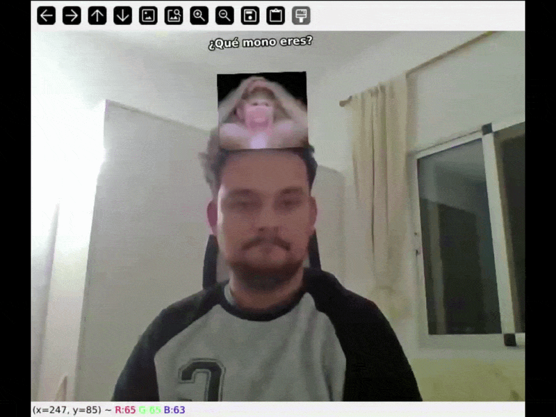
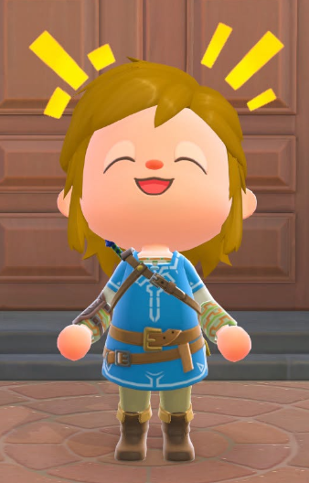

# Práctica 5. Biometría: Detección y caracterización de caras

## Tabla de contenidos
- [Introducción](#introduccion)
- [Configuración del entorno](#configuración-del-entorno)
- [Filtros](#filtros)
    - [Yo soy tú, tú eres yo](#yo-soy-tú-tú-eres-yo)
    - [¿Qué mono eres?](#qué-mono-eres)
    - [El viaje de Manzanas](#el-viaje-de-manzanas)
- [Detector de emociones en tiempo real](#detector-de-emociones-en-tiempo-real)
- [Fuentes y recursos](#fuentes-consultadas-y-recursos)

## Introducción

En el cuaderno VC_P5 correspondiente a la [quinta práctica de la asignatura](https://github.com/otsedom/otsedom.github.io/tree/main/VC/P5) se proponen una serie de tareas que deben ser completadas. A continuación, se presenta una explicación de las distintas tareas propuestas y como se han resuelto para completarlas con éxito.

## Configuración del entorno

Previo a la realización de las tareas, se deberá realizar la configuración de un nuevo entorno de anaconda con las siguientes características.

```
# Creación del entorno básico (obtenido del README)
conda create --name VC_P5 python=3.11.5
conda activate VC_P5
pip install matplotlib
pip install mtcnn
pip install tensorflow   
pip install deepface
pip install tf-keras
pip install opencv-python==4.12.0.88

pip install facenet-pytorch
pip install mediapipe

# Para hacer uso de la GPU cuando sea necesario, se ha instalado CUDA

pip install torch==2.11.0+cu128 torchaudio==2.11.0+cu128 torchvision==0.26.0+cu128 --index-url https://download.pytorch.org/whl/cu128
```

Una vez completada la instalación se podrá comenzar sin inconveniente alguno la práctica.

## Filtros

Como primera parte de la práctica, se plantea la realización de un filtro a partir de la extracción de información biométrica. Para ello, y en base a lo expuesto en el guión práctico, se han implementado las siguientes propuestas.

### Yo soy tú, tú eres yo

Inspirado en el aclamado _JRPG_ (japanese role-playing game, juego de rol por turnos japonés en español) Persona 5 Royal, este filtro hace uso de las máscaras de los Ladrones Fantasma para hacerte sentir uno de ellos. Únete a ellos para comenzar la revolución y cambiar el corazón de la sociedad.

<div align="center">


</div>

Con el fin de realizar la detección, se hace uso del `FaceLandmarker.task`de Mediapipe. De esta forma, se consigue realizar el seguimiento de hasta 3 caras a la vez.

Para ello, de la malla facial se extraen cinco puntos de referencia: el centro de cada ojo, la punta de la nariz y las comisuras de la boca.

Realizada la extracción, para colocar la máscara sobre la cara se calcula una transformación afín a partir de esos puntos:

- **Posición y tamaño:** la máscara se ancla en el punto medio entre los ojos y se escala según la distancia entre ellos. Para saber qué punto de la imagen debe coincidir con los ojos, el programa localiza automáticamente los dos agujeros transparentes de los ojos del PNG, de modo que cualquier máscara con esa característica funciona sin ajustes manuales.

- **Rotación:** se obtiene del ángulo de la línea que une los ojos, de forma que la máscara acompaña la inclinación de la cabeza.

- **Giro lateral:** se estima a partir del desplazamiento de la nariz respecto al punto medio de los ojos, y se usa para estrechar horizontalmente la máscara cuando se gira la cabeza.

- **Integración visual:** la máscara se mezcla con el vídeo usando su canal alfa, con un ligero difuminado en el borde. Además, su brillo se adapta al de la cara para que no destaque demasiado.

Asimismo, para asegurar la estabilidad del resultado se aplica un filtro _One Euro_ sobre los puntos detectados (suaviza cuando la cabeza está quieta y reacciona rápido cuando se mueve). Además, cada cara se sigue entre fotogramas y, si la detección falla durante unos pocos fotogramas, el filtro se mantiene en lugar de parpadear.

### ¿Qué mono eres?

Es bien sabido que el ser humano comparte ancestro común con los monos de modo que... ¿no te gustaría saber que tipo de mono emocional serías?. Tal vez incluso descubras que te pareces mucha más a alguno de ellos de lo que te imaginabas... 

<div align="center">



</div>

Este filtro actúa de manera similar a una ruleta: sobre la cabeza de cada persona detectada van apareciendo rápidamente diferentes imágenes y gradualmente decrece en velocidad hasta que te revela el resultado. Al igual que en el filtro anterior se hace uso de la detección, seguimiento y estimación de la pose, aunque en lugar de una máscara se dibuja la imagen flotante mencionada anteriormente.

El funcionamiento de esta ruleta se relata a continuación:

- Al detectar una cara, se empiezan a mostrar imágenes de monos de forma rápida y va frenando progresivamente hasta detenerse en el resultado final, que se elige al azar según unos pesos configurables (por defecto, todas tienen el mismo peso).

- Al revelar el resultado se aplica una pequeña animación de "rebote" en el tamaño de la carta.

- Cada cara detectada tiene su propia ruleta independiente, y con la barra espaciadora se vuelve a girar.

### El viaje de Manzanas

Inspirado en el juego para móviles [Flappy Bird](https://en.wikipedia.org/wiki/Flappy_Bird), este filtro pretende hacer homenaje representando el viaje de Manzanas hacia su hogar. Manzanas (protagonista de este minijuego y NPC de [Stardew Valley Expanded](https://stardew-valley-expanded.fandom.com/wiki/Apples)), alejado del Bosque Junimo, tratará de emprender un viaje de vuelta a su hogar esquivando los diferentes obstáculos que se le presenten en su camino.

<div align="center">


</div>

Para ayudar a Manzanas en este viaje, se han implementado dos variantes de control:

- **Con la mano:** se utiliza el `HandLandmarker.task` de Mediapipe y se toma como referencia la punta del dedo índice. El personaje sigue la altura del dedo con un suavizado ajustable.

- **Con la nariz:** se utiliza el `FaceLandmarker.tash` y se toma la punta de la nariz. La primera posición detectada se toma como punto neutro, y el desplazamiento respecto a ella se amplifica para que no haga falta mover mucho la cabeza.

En ambos escenarios el personaje solo se mueve en vertical, inclinándose ligeramente el sprite según su volocidad vertical. Asimismo, si no se detectase la mano o la cara, el juego se pausará. 

En lo que respecta a la lógica del minijuego:

- **Obstáculos:** son pares de obeliscos (uno arriba, invertido, y otro abajo) que avanzan hacia el personaje, dejando un hueco por el que hay que pasar. La altura del hueco es aleatoria.

- **Dificultad:** cada obstáculo superado suma un punto, y con la puntuación el hueco se estrecha y la velocidad aumenta hasta un máximo.

- **Colisiones:** se calculan con una hitbox rectangular obtenida automáticamente a partir de la zona no transparente del sprite. Con la tecla `d` se puede visualizar para depurar.

- **Partida:** al chocar aparece la pantalla de _Game Over_ y con `r` se reinicia, conservando la mejor puntuación de la sesión.

## Detector de emociones en tiempo real

Como segunda propuesta, se ha implementado un detector de emociones en tiempo real que diferencia entre emociones. Asimismo para cada emoción detectada, se asocia un filtro que trata de imitar a las típicas reacciones de juegos como Animal Crossing o personajes anime.

| Inspiración felicidad | Inspiración sorpresa | Inspiración enfado|
| :---: | :---: | :---: |
|  |  |  |

A continuación, se muestran los efectos asociados a cada emoción contemplada en el clasificador:

| Enfado | Asco | Miedo | Felicidad | Tristeza | Sorpresa |
| :---: | :---: | :---: | :---: | :---: | :---: |
|  |  |  |  |  |  |

Con el fin de conseguir este objetivo, se entrenó a los distintos clasificadores con el dataset de Kaggle [Emotion Detection: FER - 2013 dataset with 7 emotion types](https://www.kaggle.com/datasets/ananthu017/emotion-detection-fer/data). A continuación, se presenta la estructura del mencionado conjunto de datos:

```
├── dataset/
│   ├── test/
│   |   ├── angry/
│   |   ├── contempt/
│   |   ├── disgust/
|   |   ├── fear/
|   |   ├── happy/
|   |   ├── neutral/
|   |   ├── sad/
│   |   └── surprise/
│   ├── train/
│   |   ├── angry/
│   |   ├── contempt/
│   |   ├── disgust/
|   |   ├── fear/
|   |   ├── happy/
|   |   ├── neutral/
|   |   ├── sad/
│   |   └── surprise/
│   └── validation/
|       ├── angry/
│       ├── contempt/
│       ├── disgust/
|       ├── fear/
|       ├── happy/
|       ├── neutral/
|       ├── sad/
│       └── surprise/
```

Si bien se contemplan 8 emociones en el conjunto de datos y en el entrenamiento, a la hora de la clasificación en tiempo real se ha decidido omitir la detección de las emociones `contempt` y `neutral`.


## Fuentes consultadas y recursos

- [Documentación de OpenCV](https://docs.opencv.org/4.13.0/d6/d00/tutorial_py_root.html)
- [Guión práctico](https://github.com/otsedom/otsedom.github.io/tree/main/VC/P5)
- [Página de Mediapipe](https://developers.google.com/edge/mediapipe/solutions)
- [Vídeo sobre Mediapipe](https://www.youtube.com/watch?v=g3rf45w23NI)
- [Sprites Stardew Valley](https://es.stardewvalleywiki.com/Stardew_Valley_Wiki) (Créditos a Eric Barone, creador del juego)
- [Emotion Detection: FER - 2013 dataset with 7 emotion types](https://www.kaggle.com/datasets/ananthu017/emotion-detection-fer/data)
