# Práctica 5. Biometría: Detección y caracterización de caras

## Tabla de contenidos
- [Introducción](#introduccion)
- [Configuración del entorno](#configuración-del-entorno)
- [Filtros](#filtros)
    - [Yo soy tú, tú eres yo](#yo-soy-tú-tú-eres-yo)
    - [¿Qué mono eres?](#qué-mono-eres)
    - [El viaje de Manzanas](#el-viaje-de-manzanas)
- [Detector de emociones en tiempo real](#detector-de-emociones-en-tiempo-real)
    - [Detección y preparación de la cara](#detección-y-preparación-de-la-cara)
    - [Clasificadores entrenados](#clasificadores-entrenados)
    - [Comparativa de resultados](#comparativa-de-resultados)
    - [Demostrador en tiempo real](#demostrador-en-tiempo-real)
- [Fuentes y recursos](#fuentes-consultadas-y-recursos)

## Introducción

En el cuaderno VC_P5 correspondiente a la [quinta práctica de la asignatura](https://github.com/otsedom/otsedom.github.io/tree/main/VC/P5) se proponen una serie de tareas que deben ser completadas. A continuación, se presenta una explicación de las distintas tareas propuestas y como se han resuelto para completarlas con éxito.

## Configuración del entorno

Previo a la realización de las tareas, se deberá realizar la configuración de un nuevo entorno de anaconda con las siguientes características.

```
# Creación del entorno básico (obtenido del README)
conda create --name VC_P5 python=3.11.5
conda activate VC_P5
pip install matplotlib
pip install mtcnn
pip install tensorflow   
pip install deepface
pip install tf-keras
pip install opencv-python==4.12.0.88

pip install facenet-pytorch
pip install mediapipe

# Para hacer uso de la GPU cuando sea necesario, se ha instalado CUDA

pip install torch==2.11.0+cu128 torchaudio==2.11.0+cu128 torchvision==0.26.0+cu128 --index-url https://download.pytorch.org/whl/cu128
```

Una vez completada la instalación se podrá comenzar sin inconveniente alguno la práctica.

## Filtros

Como primera parte de la práctica, se plantea la realización de un filtro a partir de la extracción de información biométrica. Para ello, y en base a lo expuesto en el guión práctico, se han implementado las siguientes propuestas.

### Yo soy tú, tú eres yo

Inspirado en el aclamado _JRPG_ (japanese role-playing game, juego de rol por turnos japonés en español) Persona 5 Royal, este filtro hace uso de las máscaras de los Ladrones Fantasma para hacerte sentir uno de ellos. Únete a ellos para comenzar la revolución y cambiar el corazón de la sociedad.

<div align="center">

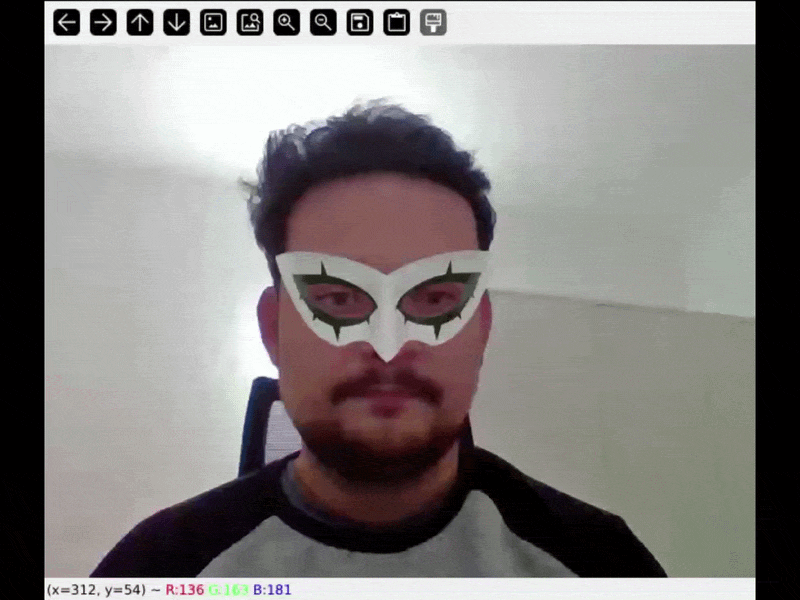

</div>

Con el fin de realizar la detección, se hace uso del `FaceLandmarker.task`de Mediapipe. De esta forma, se consigue realizar el seguimiento de hasta 3 caras a la vez.

Para ello, de la malla facial se extraen cinco puntos de referencia: el centro de cada ojo, la punta de la nariz y las comisuras de la boca.

Realizada la extracción, para colocar la máscara sobre la cara se calcula una transformación afín a partir de esos puntos:

- **Posición y tamaño:** la máscara se ancla en el punto medio entre los ojos y se escala según la distancia entre ellos. Para saber qué punto de la imagen debe coincidir con los ojos, el programa localiza automáticamente los dos agujeros transparentes de los ojos del PNG, de modo que cualquier máscara con esa característica funciona sin ajustes manuales.

- **Rotación:** se obtiene del ángulo de la línea que une los ojos, de forma que la máscara acompaña la inclinación de la cabeza.

- **Giro lateral:** se estima a partir del desplazamiento de la nariz respecto al punto medio de los ojos, y se usa para estrechar horizontalmente la máscara cuando se gira la cabeza.

- **Integración visual:** la máscara se mezcla con el vídeo usando su canal alfa, con un ligero difuminado en el borde. Además, su brillo se adapta al de la cara para que no destaque demasiado.

Asimismo, para asegurar la estabilidad del resultado se aplica un filtro _One Euro_ sobre los puntos detectados (suaviza cuando la cabeza está quieta y reacciona rápido cuando se mueve). Además, cada cara se sigue entre fotogramas y, si la detección falla durante unos pocos fotogramas, el filtro se mantiene en lugar de parpadear.

### ¿Qué mono eres?

Es bien sabido que el ser humano comparte ancestro común con los monos de modo que... ¿no te gustaría saber que tipo de mono emocional serías?. Tal vez incluso descubras que te pareces mucha más a alguno de ellos de lo que te imaginabas... 

<div align="center">


</div>

Este filtro actúa de manera similar a una ruleta: sobre la cabeza de cada persona detectada van apareciendo rápidamente diferentes imágenes y gradualmente decrece en velocidad hasta que te revela el resultado. Al igual que en el filtro anterior se hace uso de la detección, seguimiento y estimación de la pose, aunque en lugar de una máscara se dibuja la imagen flotante mencionada anteriormente.

El funcionamiento de esta ruleta se relata a continuación:

- Al detectar una cara, se empiezan a mostrar imágenes de monos de forma rápida y va frenando progresivamente hasta detenerse en el resultado final, que se elige al azar según unos pesos configurables (por defecto, todas tienen el mismo peso).

- Al revelar el resultado se aplica una pequeña animación de "rebote" en el tamaño de la carta.

- Cada cara detectada tiene su propia ruleta independiente, y con la barra espaciadora se vuelve a girar.

### El viaje de Manzanas

Inspirado en el juego para móviles [Flappy Bird](https://en.wikipedia.org/wiki/Flappy_Bird), este filtro pretende hacer homenaje representando el viaje de Manzanas hacia su hogar. Manzanas (protagonista de este minijuego y NPC de [Stardew Valley Expanded](https://stardew-valley-expanded.fandom.com/wiki/Apples)), alejado del Bosque Junimo, tratará de emprender un viaje de vuelta a su hogar esquivando los diferentes obstáculos que se le presenten en su camino.


Para ayudar a Manzanas en este viaje, se han implementado dos variantes de control:

- **Con la mano:** se utiliza el `HandLandmarker.task` de Mediapipe y se toma como referencia la punta del dedo índice. El personaje sigue la altura del dedo con un suavizado ajustable.

<div align="center">

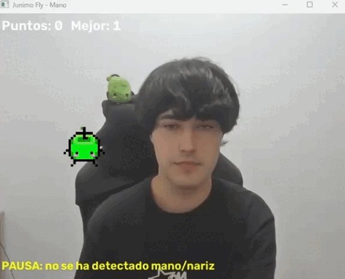

</div>

- **Con la nariz:** se utiliza el `FaceLandmarker.task` y se toma la punta de la nariz. La primera posición detectada se toma como punto neutro, y el desplazamiento respecto a ella se amplifica para que no haga falta mover mucho la cabeza.

<div align="center">

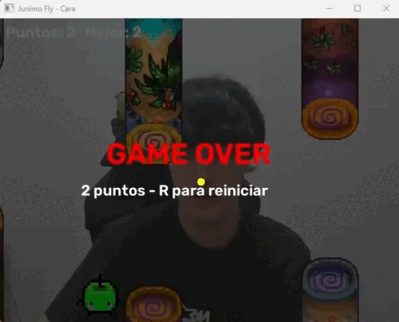

</div>

En ambos escenarios el personaje solo se mueve en vertical, inclinándose ligeramente el sprite según su volocidad vertical. Asimismo, si no se detectase la mano o la cara, el juego se pausará. 

En lo que respecta a la lógica del minijuego:

- **Obstáculos:** son pares de obeliscos (uno arriba, invertido, y otro abajo) que avanzan hacia el personaje, dejando un hueco por el que hay que pasar. La altura del hueco es aleatoria.

- **Dificultad:** cada obstáculo superado suma un punto, y con la puntuación el hueco se estrecha y la velocidad aumenta hasta un máximo.

- **Colisiones:** se calculan con una hitbox rectangular obtenida automáticamente a partir de la zona no transparente del sprite. Con la tecla `d` se puede visualizar para depurar.

- **Partida:** al chocar aparece la pantalla de _Game Over_ y con `r` se reinicia, conservando la mejor puntuación de la sesión.

## Detector de emociones en tiempo real

Como segunda propuesta, se ha implementado un detector de emociones en tiempo real que diferencia entre emociones. Asimismo para cada emoción detectada, se asocia un filtro que trata de imitar a las típicas reacciones de juegos como Animal Crossing o personajes anime.

| Inspiración felicidad | Inspiración sorpresa | Inspiración enfado|
| :---: | :---: | :---: |
|  |  |  |

A continuación, se muestran los efectos asociados a cada emoción contemplada en el clasificador:

| Enfado | Asco | Miedo | Felicidad | Tristeza | Sorpresa |
| :---: | :---: | :---: | :---: | :---: | :---: |
|  | 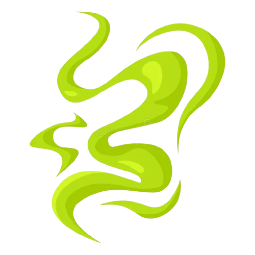 |  |  |  |  |

Con el fin de conseguir este objetivo, se entrenó a los distintos clasificadores con el dataset de Kaggle [Emotion Detection: FER - 2013 dataset with 7 emotion types](https://www.kaggle.com/datasets/ananthu017/emotion-detection-fer/data). A continuación, se presenta la estructura del mencionado conjunto de datos:

```
├── dataset/
│   ├── test/
│   |   ├── angry/
│   |   ├── contempt/
│   |   ├── disgust/
|   |   ├── fear/
|   |   ├── happy/
|   |   ├── neutral/
|   |   ├── sad/
│   |   └── surprise/
│   ├── train/
│   |   ├── angry/
│   |   ├── contempt/
│   |   ├── disgust/
|   |   ├── fear/
|   |   ├── happy/
|   |   ├── neutral/
|   |   ├── sad/
│   |   └── surprise/
│   └── validation/
|       ├── angry/
│       ├── contempt/
│       ├── disgust/
|       ├── fear/
|       ├── happy/
|       ├── neutral/
|       ├── sad/
│       └── surprise/
```

Si bien se contemplan 8 emociones en el conjunto de datos y en el entrenamiento, a la hora de la clasificación en tiempo real se ha decidido omitir la detección de las emociones `contempt` y `neutral`.
 
El reparto de imágenes (todas en escala de grises) es el siguiente:
 
| Partición | Imágenes | Distribución |
| :---: | :---: | :--- |
| `train` | 66 379 | 8000 por clase, salvo `neutral` con 10 379 |
| `validation` | 8341 | 1000 por clase, salvo `neutral` con 1341 |
| `test` | 3573 | Desbalanceada (p. ej. 1274 `neutral`, 929 `happy`, 21 `disgust`, 30 `contempt`) |
 
> **Nota:** en el conjunto de datos la carpeta de la sorpresa se llama `suprise` (sin la _r_). Por este motivo, en el código las clases y los diccionarios de colores, nombres e iconos utilizan esa grafía, y se define una equivalencia `surprise → suprise` para las comparaciones con DeepFace.
 
### Detección y preparación de la cara
 
Antes de clasificar, hay que localizar las caras en cada fotograma. Para ello se han contemplado dos detectores, que se pueden intercambiar en directo con la tecla `d`:
 
- **Haar Cascade de OpenCV** (`haarcascade_frontalface_default.xml`): rápido y ligero, pero solo devuelve la caja de la cara. Al no disponer de puntos de referencia, la posición de los ojos se estima a partir de la caja (al 30 % y 70 % del ancho y al 40 % del alto).
- **MTCNN:** más robusto, devuelve además los puntos clave de la cara (ojos, nariz y comisuras de la boca). Se descartan las detecciones con una confianza inferior a 0.9.
Una vez detectada cada cara, se prepara la entrada del clasificador (`preparar_cara`):
 
1. Si se dispone de puntos clave (MTCNN), se **alinea** la cara rotando la imagen según el ángulo de la línea que une ambos ojos.
2. Se recorta la caja de la cara ampliada con un **margen del 10 %**.
3. Se redimensiona a **112×112** píxeles en escala de grises, el mismo formato con el que se entrenaron los modelos.

### Clasificadores entrenados
 
Se han entrenado y comparado tres clasificadores distintos, además de evaluar el modelo preentrenado de DeepFace como referencia externa. Para cada uno se guarda el modelo y su matriz de confusión normalizada.
 
#### Entrenamiento 1: clasificador clásico (HOG + PCA + SVM)
 
Como aproximación clásica, sin aprendizaje profundo, se extraen características manualmente y se clasifican con una máquina de vectores soporte:
 
- **Características:** descriptor HOG (_Histogram of Oriented Gradients_) sobre la cara a 112×112, con 9 orientaciones, celdas de 8×8 píxeles y bloques de 2×2 celdas (normalización `L2-Hys`). Cada imagen queda representada por un vector de 6084 valores. La extracción se paraleliza con `joblib` para acelerar la carga de las más de 66 000 imágenes.
- **Pipeline:** `StandardScaler` → `PCA` (150 componentes) → `SVC` con núcleo RBF y `class_weight="balanced"` para compensar el desbalance de clases.
- **Búsqueda de hiperparámetros:** `GridSearchCV` con validación cruzada de 3 particiones y métrica `f1_macro`, sobre una submuestra de 5000 imágenes (para que sea rápido), probando `C ∈ {1, 10, 100}` y `gamma ∈ {scale, 0.001, 0.0001}`. La mejor combinación fue `C = 10` y `gamma = scale`.
- **Entrenamiento final:** con esos parámetros se reentrena sobre todo el conjunto de `train` y se evalúa sobre `test`. El modelo se guarda en `train1/emociones_clasico.joblib`.
Resultados sobre `test`: **accuracy 0.69** y **F1 macro 0.576**. Funciona bien en las clases más abundantes (`happy`, `neutral` y `suprise`), pero le cuestan las minoritarias como `contempt`, `disgust` y `fear`, con un recall muy bajo.
 
<div align="center">

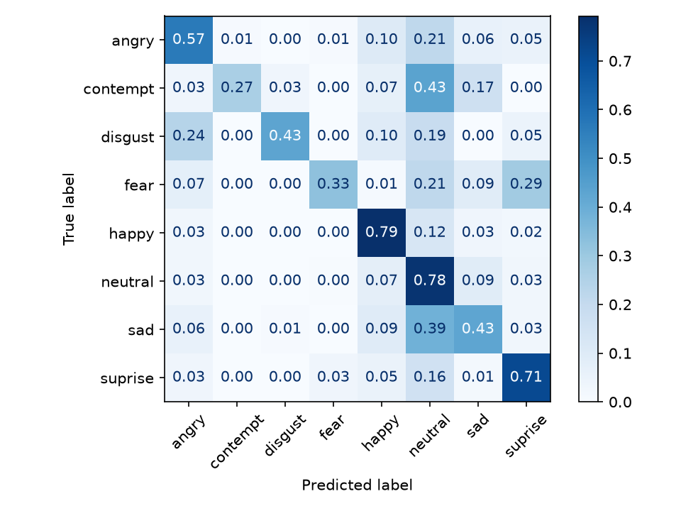

</div>

#### Entrenamiento 2: CNN propia en Keras
 
Una red convolucional sencilla entrenada desde cero sobre imágenes en escala de grises de 112×112:
 
```
Input (112×112×1) → Rescaling(1/255) → RandomFlip(horizontal) → RandomRotation(0.05)
→ Conv2D(32) → MaxPooling → Conv2D(64) → MaxPooling → Conv2D(128)
→ Flatten → Dropout(0.4) → Dense(128) → Dense(8, softmax)
```
 
- Los datos se cargan con `image_dataset_from_directory` (lotes de 64), usando `train` para entrenar y `validation` para validar.
- La capa de `RandomFlip` y `RandomRotation` actúan como aumento de datos, y el `Dropout` reduce el sobreajuste.
- Se entrena con `adam` y `categorical_crossentropy` durante un máximo de 30 épocas, con `EarlyStopping` (paciencia 5 y recuperación de los mejores pesos).
- El modelo se guarda en `train2/emociones.keras`, y su matriz de confusión en `train2/matriz_confusion_cnn.png`.
<div align="center">

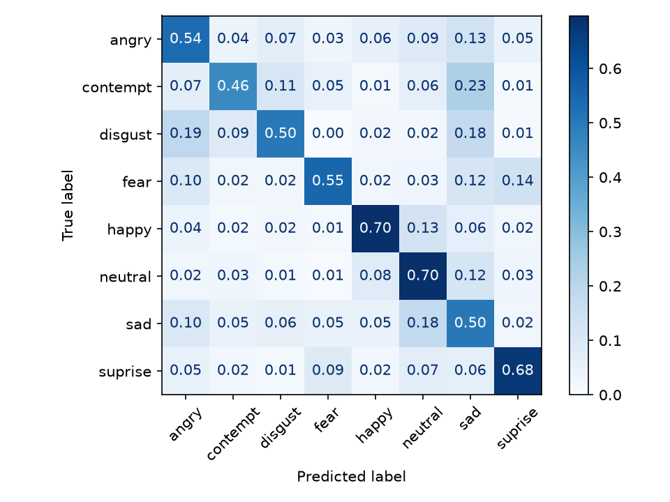
 
</div>

#### Entrenamiento 3: _transfer learning_ con ResNet50V2
 
Con el fin de mejorar los resultados se aprovecha una red preentrenada en ImageNet (`ResNet50V2`, sin la capa de clasificación y con `pooling="avg"`). Como la red espera imágenes de 3 canales, la entrada en gris se reescala a `[-1, 1]`, se le aplica aumento de datos (volteo horizontal y rotación) y se replica tres veces para obtener los 3 canales. Sobre la ResNet se añade un `Dropout(0.4)` y una capa `Dense` con _softmax_.
 
El entrenamiento se realiza en dos fases:
 
- **Fase 1 (cabeza):** se congela la ResNet y solo se entrena la capa de clasificación con `Adam(1e-3)` durante un máximo de 4 épocas.
- **Fase 2 (ajuste fino):** se descongelan las últimas 50 capas de la ResNet (dejando las capas `BatchNormalization` congeladas) y se continúa con `Adam(1e-4)` durante un máximo de 8 épocas.
En ambas fases se usa `EarlyStopping` (paciencia 3, con recuperación de los mejores pesos). El modelo final se guarda en `train2/emociones_resnet.keras`.
 
Resultados sobre `validation`: **accuracy 0.67** y **F1 macro 0.672**. Tras la primera fase la precisión de validación se queda en torno al 50 %, y con el ajuste fino sube hasta cerca del 68 %. Cabe destacar que a partir de la segunda época de la fase 2 el _loss_ de validación empieza a empeorar mientras la precisión de entrenamiento sigue creciendo (hasta ≈0.90), señal de sobreajuste, y es justo el motivo por el cual se recuperan los mejores pesos con `EarlyStopping`. La clase más difícil resulta ser `sad`, mientras que `happy` obtiene la mayor precisión (0.94).
 
<div align="center">

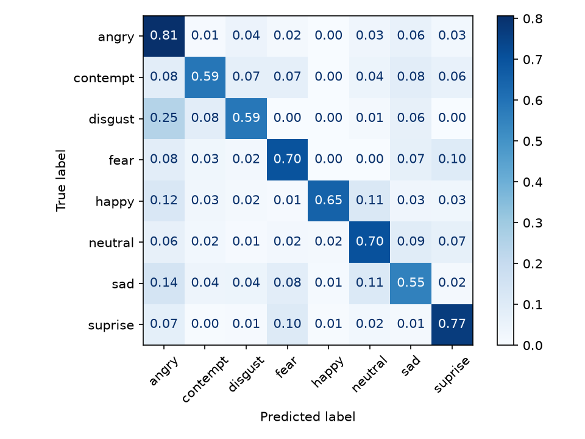
 
</div>

#### Referencia externa: DeepFace

Como punto de comparación se ha evaluado sobre el mismo conjunto de `validation` el analizador de emociones de [DeepFace](https://github.com/serengil/deepface) (`DeepFace.analyze` con la acción `emotion`). Puesto que las imágenes ya son caras recortadas, se desactiva la detección (`detector_backend="skip"`).
 
Resultados: **accuracy 0.44** y **F1 macro 0.412**. Este modelo no contempla la clase `contempt` (con lo que siempre falla en ella), y funciona mejor en `happy` y `suprise`.
 
<div align="center">

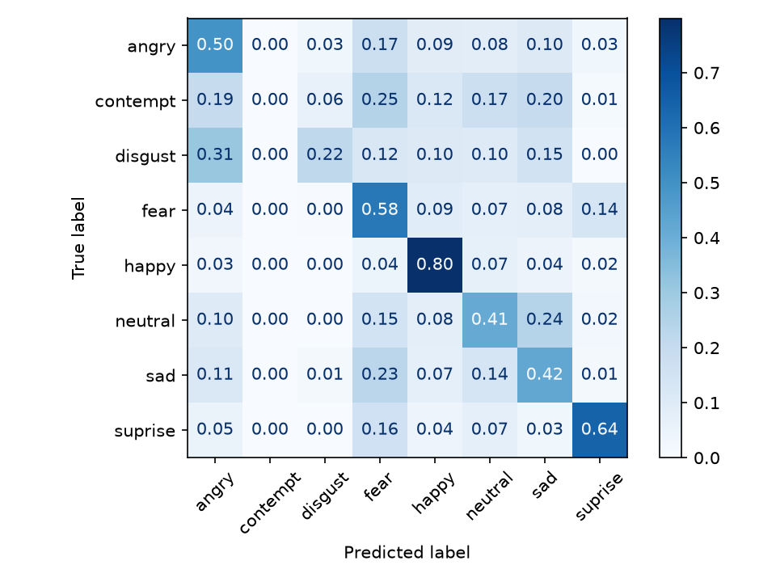
 
</div>

### Comparativa de resultados
 
| Modelo | Evaluado sobre | Accuracy | F1 macro |
| :--- | :---: | :---: | :---: |
| HOG + PCA + SVM (clásico) | `test` | 0.69 | 0.576 |
| CNN propia (Keras) | `validation` | 0.584 | 0.58 |
| ResNet50V2 (_transfer learning_) | `validation` | 0.67 | 0.672 |
| DeepFace (preentrenado) | `validation` | 0.44 | 0.412 |
 
Es importante tener en cuenta que los resultados no son directamente comparables entre sí: el modelo clásico se evalúa sobre `test`, donde las clases minoritarias (`contempt` y `disgust`) cuentan con apenas 30 y 21 imágenes, mientras que el resto se evalúan sobre `validation`, que tiene 1000 imágenes por clase. Por ello, a pesar de que la accuracy del clásico parezca la más alta, la ResNet50V2 es el modelo que mejor equilibrio obtiene entre las distintas emociones (mayor F1 macro) y, por tanto, el elegido para el demostrador principal.

### Demostrador en tiempo real
 
El demostrador abre la cámara y, para cada cara detectada, ejecuta el clasificador y dibuja el resultado sobre el vídeo. Se han implementado dos versiones del bucle: una con el modelo de ResNet50V2 (`demo`) y otra con el clasificador clásico (`demo_clasico`), además de la de Keras con la CNN propia. El resto del procesamiento (detección, preparación y efectos) es común a todos.
 
- **Suavizado temporal:** para evitar que la emoción parpadee de un fotograma a otro, se promedian las probabilidades de los últimos 8 fotogramas de cada cara.
- **Emociones ignoradas:** las probabilidades de `neutral` y `contempt` se ponen a cero y se renormaliza el resto, de forma que siempre se muestra una de las seis emociones con efecto.
- **Información en pantalla:** junto a cada cara se escribe la emoción y su porcentaje, y para la cara más grande se dibuja un panel con barras con la probabilidad de cada emoción.
- **Modelo clásico:** al no ofrecer probabilidades, se aplica una función _softmax_ sobre la salida de `decision_function` del SVM (con un parámetro `TEMP` para acentuar las diferencias).
- **Efectos asociados a cada emoción:** los iconos PNG (con canal alfa) se pegan sobre el vídeo recortando lo que se salga de la imagen. Si falta algún icono, se dibuja un círculo de color como respaldo.
- **Controles:** `d` cambia entre los detectores Haar y MTCNN, `e` muestra u oculta los puntos de referencia de MTCNN y `ESC` cierra el programa.

| Demostrador clásico | Demostrador Keras (CNN) | Demostrador Resnet |
| :---: | :---: | :---: |
| 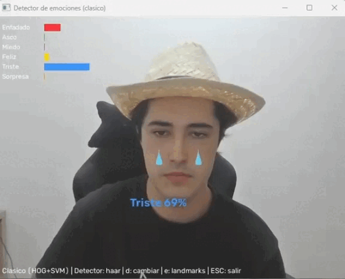 | 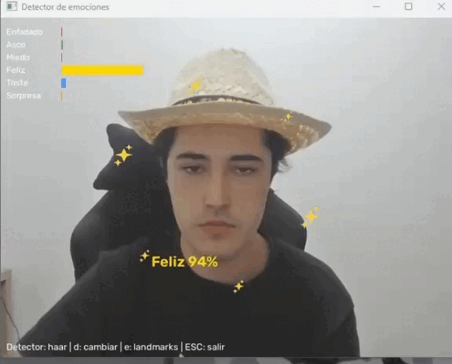 | 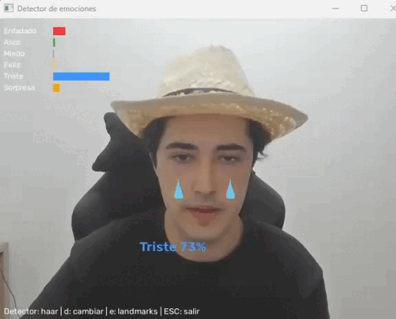 |


## Fuentes consultadas y recursos

- [Documentación de OpenCV](https://docs.opencv.org/4.13.0/d6/d00/tutorial_py_root.html)
- [Guión práctico](https://github.com/otsedom/otsedom.github.io/tree/main/VC/P5)
- [Página de Mediapipe](https://developers.google.com/edge/mediapipe/solutions)
- [Vídeo sobre Mediapipe](https://www.youtube.com/watch?v=g3rf45w23NI)
- [Máscara de Joker](https://shopmadmasks.com/persona-5-joker-mask/?srsltid=AY6E963GoES9A16tuPi7xjmLMDBQTtPlgfp7A55ECqfxm7vngUo7-lOp)
- [Máscara de Panther](https://www.kindpng.com/imgv/JbhRb_persona5-anntakamaki-cat-panther-mask-persona-5-panther/)
- [Máscara de Violet](https://www.play-asia.com/es/persona-5-royal-replica-mask-violet/13/70jdnt)
- [Sprites Stardew Valley](https://es.stardewvalleywiki.com/Stardew_Valley_Wiki) (Créditos a Eric Barone, creador del juego)
- [Emotion Detection: FER - 2013 dataset with 7 emotion types](https://www.kaggle.com/datasets/ananthu017/emotion-detection-fer/data)
- [DeepFace (librería de análisis facial)](https://github.com/serengil/deepface)
- [Keras Applications: ResNet50V2](https://keras.io/api/applications/resnet/)
- [Documentación de scikit-learn](https://scikit-learn.org/stable/)
